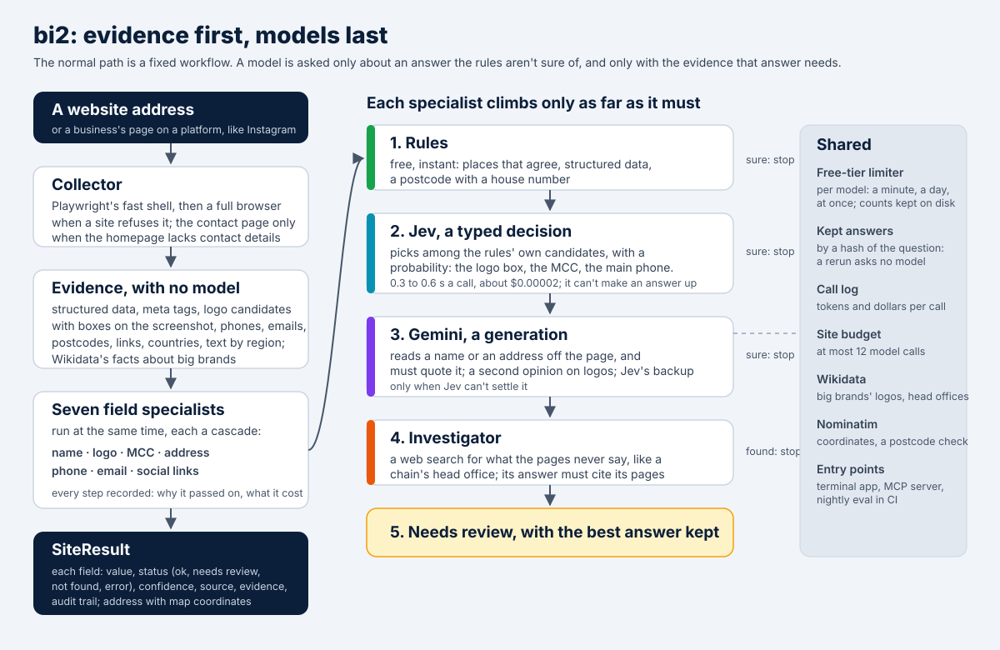
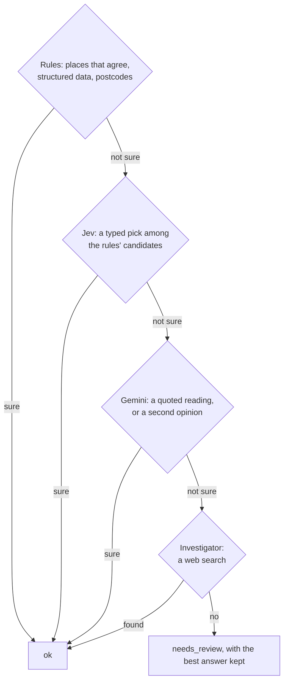

# Business Insights v2: architecture draft

Status: built, 2026-10-20. Every field of v2.0 is built: name, logo, MCC, head-office address with coordinates, phone, email and social links, with the AI pass, the MCP server and CI/CD. The website demo comes next. The scores are in [costs.md](costs.md) and [PROGRESS.md](../PROGRESS.md).



## Goal

Produce v1's four fields (company name, logo, MCC, headquarters address), plus the business's phone number, email address and social media links, and do it cheaper, more accurate and faster. The users are bank teams: merchant onboarding and underwriting, KYB, merchant risk, and transaction enrichment. Banking-specific fields (legal name, website compliance checklist, product risk and so on) come after v2.0 and reuse the same design.

## Product shape

- **The terminal app is the product.** v2 is open source (MIT, like v1). Anyone can install it, add their own API keys, and run it on their own machine. It needs no account and no server of ours.
- **The website is a demo.** It lets people who aren't technical try v2 in a browser. They sign up, get 3 free analyses, and then add their own keys to keep going. Results for the same site are shared between users.
- **Both run the same pipeline code.**

## What v1 taught us

| Finding | Evidence |
|---|---|
| Most tokens are HTML markup | The brand call sends 4K–104K tokens of cleaned HTML per homepage. The visible text on the same pages is 17–159× smaller (measured on 3 of the test sites). |
| Free structured data is thrown away | All 3 sampled homepages embed schema.org JSON-LD with a logo. Bellwoods' also lists address, phone, social links, hours and coordinates. v1's `clean_html` deletes every `<script>` tag, including these. |
| The MCC rules are biased | Keyword rules match substrings, so "eat" matches "great" and "menu" matches almost every navigation bar, and most sites are told they are food businesses. Travel rules send hotels, airlines and car rentals to chain-only code ranges, where the generic codes (7011, 4511, 7512) don't exist. |
| Failures look like answers | A failed MCC call becomes 5812 ("restaurant") marked as a success. Geocoding replaces the published address with the geocoder's first match. |
| Most run time is waiting | A 24-site run spends about 25 minutes in fixed sleeps, and sites are processed one at a time. |
| Nothing can be measured | There is no ground truth and there are no tests, and token counts cover only the brand call. |

## Design principles

1. **Evidence first, models last.** Collect what the page offers once, in a compact typed form. Models never see raw HTML.
2. **Use the cheapest source that can answer.** Free sources first, then a typed decision, then an LLM, then a human. Escalate only on missing data, disagreement or low confidence.
3. **Typed in, typed out.** Every stage takes and returns Pydantic models, and every model call has a schema.
4. **No silent defaults.** Each field ends as `ok`, `needs_review`, `not_found` or `error`.
5. **Show the source.** Each field records where it came from and the supporting text, so an analyst can check it.
6. **Measure everything.** A gold set and an eval runner exist before the first optimization.
7. **One pipeline, two ways to run.** The terminal app and the website run the same pipeline code. Only the storage, job, rate-limit and key-handling pieces differ.

## Tech stack

| Layer | Choice | Role |
|---|---|---|
| Language | Python 3.12 or newer | Everything except the website's front end |
| Terminal app | Typer for commands, Rich for live progress and tables, prompt_toolkit for the interactive session's input line | The main product |
| Distribution | A PyPI package (install with pip, pipx or uv), plus a Docker image with the browser preinstalled | How people get the terminal app |
| Browser | Playwright | Rendered pages, logo positions, element screenshots |
| Decisions | Jev, TypeSafe's typed-decision model, over its REST API | Picks among the rules' own candidates with a probability for each: the logo box, the MCC, the main phone. 0.3 to 0.6 seconds a call, and it can't make an answer up |
| Generation | Gemini (Flash-Lite first, then Flash), over its REST API | Reads what no candidate covers, and must quote the page; Jev's backup and second opinion |
| MCC | Jev, picking from the official code list in two rounds | Replaced the planned embedding search: Jev reads pages in any language, needs no model download, and the whole list costs about $0.0002 a site |
| Knowledge and maps | Wikidata, and OpenStreetMap's Nominatim | Free: big brands' logo files and head offices; every address's coordinates |
| MCP | The official `mcp` SDK (2.x) | `bi2 mcp`, for AI assistants |
| Observability | OpenTelemetry, plus an LLM-call log | Traces for every pipeline step; tokens, cost, model and prompt version for every model call. In the terminal app the log is a local file, and each run ends with a cost summary. |
| CI/CD | GitHub Actions (assumed) | See "Delivery" |
| Website API | FastAPI, REST, OpenAPI/Swagger | The demo website's backend. Swagger docs and the website's typed client come from the same spec. |
| Website data | PostgreSQL | Users, encrypted keys, jobs, results, evidence, and (at demo size) screenshots and logos |
| Website queue, limits, cache | Redis | Job queue and progress, per-key rate limits, short-term cache. Holds nothing that can't be rebuilt, and never holds keys. |
| Website accounts | OAuth sign-in (Google, GitHub) through a maintained library (proposed) | Sign-up without storing passwords |
| Website secrets | The hosting platform's secret manager | The master key that encrypts users' API keys, and the project's key for free tries |
| Website front end | React | Sign up, add keys, submit a URL, watch progress, see each field with its source |
| Containers | Docker, plus Docker Compose for local development | The terminal-app image, and the website's API, worker and front-end images |
| Later | MCP server; Terraform | Access from AI assistants; infrastructure as code if the website moves straight to a cloud provider |

Considered and not used, because v2 doesn't need them at its size: Java and Spring, Maven and Gradle (uv is the Python equivalent), Kafka, Spark, Airflow, Kubernetes, OpenShift and Helm, microservices, Oracle, MS SQL, MySQL and NoSQL databases, formal domain-driven design, Confluence. Also pgvector (914 vectors fit in memory) and separate object storage (Postgres can hold the demo's images).

## Terminal app

- **Commands** (names to be decided):
  - `bi2 analyze <url>`: analyze one site and print each field with its status, confidence and source.
  - `bi2 analyze --file sites.txt`: analyze a list, several sites at once, with live progress.
  - `bi2 init`: create the config file and add keys.
  - `bi2 doctor`: check the keys, the browser install and network access.
  - `bi2 eval`: run the gold set (for contributors).
  - `bi2 review`: check a run's answers in the browser, right or wrong with a note, and see how often v2 is right (for contributors).
- **Output:** a readable table by default, and `--json`, `--jsonl` or `--csv` for scripts and spreadsheets. Results, evidence and images are saved to a local folder.
- **Scripting:** exit codes report failures, and `--fail-on needs_review` lets a script treat unsure fields as failures.
- **Cost:** every run ends with the tokens and money spent on the user's keys.
- **Keys:** environment variables, or the operating system's keychain (`bi2 init` offers to save them there). Never the config file. They leave the machine only in calls to the providers.
- **Config:** which model to use for each task, confidence thresholds, concurrency.
- **Privacy:** no usage data is collected.

### Interactive mode

Running `bi2` with no command in a terminal opens an interactive session. The commands above stay for scripts and automation.

An example session (the sites and numbers are made up):

```
$ bi2
Business Insights v2 · profile: balanced · keys: Gemini ✓  Jev –  SerpAPI ✓
Paste URLs or a file path, or type /help.

› https://maple-taproom.ca https://northside-coffee.com

  maple-taproom.ca      ✓ fetch  ✓ evidence  ✓ name  ✓ logo  ⠋ mcc  · address
  northside-coffee.com  ✓ fetch  ✓ evidence  ✓ name  ✓ logo  ✓ mcc  ✓ address

  2 sites · 14 s · 3.1K tokens · $0.002 · 1 field needs review

› /review
  maple-taproom.ca · MCC needs review
    1. 5813  Bars, Cocktail Lounges, … Taverns     0.58  "taproom", "brewery tours"
    2. 5921  Package Stores Beer, Wine and Liquor  0.31  "bottle shop"
  Pick 1 or 2, type a code, or press Enter to skip:
```

Commands inside the session:

| Command | Does |
|---|---|
| Paste URLs or a file path | Analyze them with live progress per site, then show the results table and the cost |
| `/show <site>` | Every field with its value, status, confidence, source and supporting quotes |
| `/why <site> <field>` | The field's audit trail: which steps ran, why each one escalated, and what each cost |
| `/review` | Walk through the fields marked `needs_review`; pick a candidate, type a value, or skip |
| `/rerun <site> [profile]` | Analyze a site again, for example with the `accurate` profile |
| `/export csv` or `/export json` | Save the session's results |
| `/keys`, `/profile`, `/config` | Check which keys are set (values hidden), switch profile, show the settings |
| `/help`, `/quit` | Show help, or leave the session |

Rules:
- The session is one more way to show the same pipeline and events. It holds no analysis logic.
- It opens only when a person is at the terminal. In a script or CI job, `bi2` with no command prints the help and exits instead of waiting for input.
- Ctrl+C cancels the analysis in progress; pressing it again leaves the session.
- Values chosen in `/review` are saved with the source `analyst`, so exports show which values a person picked.
- `/why` answers come from the audit trail, with no model call. Free-form questions answered by an LLM, and exporting analyst choices as gold-set candidates, can come later.

## Two ways to run

The pipeline depends only on small interfaces for storage, jobs, rate limits, files and keys. Each interface has two implementations:

| Concern | Terminal app (local) | Website demo (hosted) |
|---|---|---|
| Where the pipeline runs | The user's own machine | Worker containers on our servers |
| Account | None | Sign-in required |
| Keys | Environment variables or the operating system's keychain | Saved in the account, encrypted |
| Jobs | Run directly in the process | Redis queue |
| Rate limits | In memory | Redis, tracked per key |
| Results, evidence, images | Files in a local folder | Postgres |
| Shared results | No | Yes, across all users |

The MCP server (later) can run in local mode, so AI assistants use the user's own keys on the user's machine.

## How a website request flows

```
Website (React) ──▶ API (FastAPI) ──────────────────────▶ Postgres
                       │          ▲                       users, encrypted keys, jobs, results,
                       │ enqueue  │ progress              evidence, images, LLM-call log
                       ▼          │ (server-sent events)
                     Redis        queue, rate limits, cache, progress
                       │          ▲
                       ▼          │
                    Worker        pipeline + browser
                       │
                       ▼
        Gemini · OpenAI · Anthropic · Jev · SerpAPI   (the user's own keys, or the project's key for free tries)
        Nominatim                                     (keyless, shared by all users)
```

1. A signed-in user submits a URL. If the site has a recent shared result (see "Shared results"), the API returns it immediately. Otherwise it checks that the user has a free try left or keys of their own, checks their quota, and adds a job to the Redis queue. The job says which keys to use (the user's own, or the project's free-try key) by ID; the keys themselves never go into the queue.
2. A worker loads and decrypts those keys, runs the pipeline with them and publishes each stage's progress to Redis. The API streams that progress to the website.
3. The worker writes the result, the evidence, the images and the LLM-call log to Postgres. The decrypted keys are discarded when the job ends.

## Accounts and user keys (website)

- **Sign-up and sign-in** go through Google or GitHub (OAuth), so v2 never stores passwords. (Proposed.)
- **Free tries.** Every new account gets 3 free analyses, run on the project maintainer's own key with a low-cost model setup. To keep going after that, the user adds their own keys.
  - Only completed analyses count as a try, and opening a shared result doesn't use one up.
  - Each Google or GitHub account gets one allowance.
  - The free-try key has a hard daily spending cap in v2. When it is reached, free tries pause until the next day; users with their own keys are unaffected. The cap's size is set from the cost per analysis measured by the eval runner.
  - The free-try key is a separate key used for nothing else, with a spending limit also set in the provider's own console, so a bug in v2's cap can't run up the bill.
  - The key lives only in the secret manager, never in the repository, which is public.
  - When the tries run out, the website explains in plain language how to get a key (for example, a Gemini key from Google AI Studio) and where to paste it.
- **Which keys** (the terminal app has no free tries, so it always needs the first one):
  - Required after the free tries: one LLM provider key (Gemini, OpenAI or Anthropic).
  - Optional: a Jev key for cheaper decisions, and a SerpAPI key for the address search step. Without SerpAPI, addresses come only from the site itself.
- **Storage:** keys are encrypted before they are saved, with a master key held in the secret manager rather than in the database or the code. They are decrypted only inside a worker, for the length of one job.
- **Handling:**
  - Each key is checked with a cheap test call when it is saved.
  - After saving, only the last four characters are ever shown.
  - Keys never appear in logs, traces, error messages or queue payloads.
  - Users can replace or delete a key at any time.
- **Models follow the keys.** The pipeline uses whichever providers the user has keys for: `JevDecider` when there is a Jev key, `LLMDecider` otherwise.
- **Rate limits are per key.** Provider limits apply to each user's own key, so the shared limiter tracks them per key.
  - Nominatim is the exception: it takes no key, and its one-request-per-second limit applies to the website as a whole.
  - If the demo gets heavy use, the free Nominatim service won't be enough, and the website will need its own geocoding server or a geocoder that accepts the user's key.
  - The terminal app doesn't have this problem, because each user geocodes from their own machine.
- **Cost transparency.** Each result shows what it cost on the user's keys, taken from the LLM-call log.

## Shared results (website)

- When a site was analyzed within the reuse window (proposed: 7 days), the next user who asks for it gets that result immediately, at no cost to their keys.
- The result shows when it was produced and which model produced it, and the user can choose to re-run it on their own keys.
- A re-run replaces the shared result for everyone.
- Fields still marked `needs_review` or `error` are re-run rather than reused.

## Pipeline

```
URL
 │
 ▼
Fetch        rendered homepage (browser) + contact/about pages (plain HTTP, browser fallback)
 │
 ▼
Evidence     no model calls:
 │           structured data (JSON-LD, microdata, OpenGraph), title, meta tags, icons
 │           logo candidates with on-screen position and size
 │           visible text by region (header, main, footer)
 │           phones, emails, postcodes, copyright line, classified links
 │           country hints (domain, language, phone codes, postcode format), one screenshot
 │           the contact page's phones and emails, when the homepage lacks a phone or a general email
 │
 ├────────────┬────────────┬────────────┐
 ▼            ▼            ▼            ▼
Name         Logo         MCC         Address        resolvers run in parallel;
 │            │            │            │            address waits for name only
 └────────────┴─────┬──────┴────────────┘            when it has to search
                    ▼
SiteResult   per field: value, status, confidence, source, evidence
```

Every resolver runs the same cascade, and stops at the first step that's sure:



| Field | Rules | Jev | Gemini | Programmatic sources |
|---|---|---|---|---|
| Name | places that agree, weighted | picks among the page's names, or none | reads it off the evidence or the top of the screenshot; must quote | Wikidata, for pages that block us |
| Logo | candidates ranked by place, links and words | picks a numbered box on the screenshot | a second opinion on the same boxes | structured data's logo; Wikidata's logo file; colors from the file |
| MCC | schema.org types as a hint | two rounds over the 319 codes that aren't one chain's, then reversed | none | chain codes, by the business's name |
| Address | structured data; lines found by postcodes or street words | picks the head office among several; says whether a page gives one | reads it off the footer and contact page; must quote | Wikidata's head office; Nominatim's coordinates |
| Phone | where each number appears | judges the main number | none | Wikidata, for pages that block us |
| Email | general addresses on the business's domain | judges the general address | none | Wikidata, for pages that block us |
| Social links | profile links and `sameAs` | none | none | Wikidata, for pages that block us |

## Platform pages

The URL a user gives may not be the business's own website. It may be the business's page on another platform: a cafe's Pinterest, Instagram, Yelp, TripAdvisor, Uber Eats or Linktree page, or its account on any other site that hosts businesses, such as review and listing sites. The result must describe the business, never the platform.

- **Detect them first.** `data/platforms.toml` lists known platforms and their profile URL patterns. For sites not on the list, the Decider answers whether the page is the business's own website or a profile on another platform.
- **Ignore the platform's own branding.** Its logo, its name in `og:site_name`, its structured data about itself and its copyright line describe the platform, so they are left out of the evidence.
- **Read the profile instead.** The name comes from the profile title, the logo from the profile picture, the business type from the bio or listing categories, and the address from the listing when it shows one.
- **Follow the business's own website** when the profile links to one, and analyze it too. The profile then becomes supporting evidence.
- **Record it.** Each result says whether the page was the business's own site or a platform profile, and which platform. A business with no website of its own is useful for risk teams to know.
- **When a platform blocks us** (a login wall, or `robots.txt`), fall back to search.

## Resolvers

### Company name

- Candidates: JSON-LD `name` and `legalName`, `og:site_name`, title-tag segments, logo alt text, the copyright line, the domain name.
- Normalize the candidates and count agreement. If two or more independent sources agree, the field is `ok`.
- Otherwise the Decider picks among the candidates. An LLM is used only when no candidate fits.

### Logo

- Candidates come from the rendered page:
  - `` tags, using the real URL from `currentSrc`, `srcset` or `data-src` so lazy-loaded logos work
  - inline `<svg>` elements and CSS background images
  - the JSON-LD logo and the page icons

  Each candidate carries its position and size, whether it is in the header, whether it links to the homepage, and its alt text and class.
  Placeholders are left out, and so are stand-ins a site shows when an image is missing, like a hidden "default image".
- A heuristic ranks the candidates. If the JSON-LD logo and the top header candidate are the same file, the field is `ok`.
- Otherwise, send the screenshot with numbered boxes plus the numbered list, and ask which number is the logo. Use Jev if it accepts images; otherwise use a small vision LLM.
- Save the logo with its real file type. For inline SVG or background-image logos, take a screenshot of the element.
- Take the logo file from the browser's own copy when it has one. While a page loads, the browser keeps copies of up to 20 images likeliest to be the logo: those in the header, linking home or named as a logo, then the rest from the top down. Some sites refuse a separate download of an image they gave the browser; in the 2026-10-12 review, six right logos were lost that way.
- Also keep the square icon (`apple-touch-icon`, favicon) for enrichment use.

### MCC

Built on 2026-10-20, with Jev rather than the planned embedding search: Jev reads the page's own words in any language, needs no model download, and costs about $0.0002 a site.

- **No keyword rules.** v1's matched substrings, so most sites came out as restaurants.
- **Round one:** the 319 codes that aren't one chain's go in two lists, since Jev takes at most 255 options a question, and Jev picks the best of each, or none, in one call. The state is the page's title, description, schema.org types, the top of the page and its main text.
- **The final round:** the three likeliest codes of each list, with their descriptions and plain-language synonyms from `data/mcc_synonyms.toml`.
- **Chains:** a code from 3000 to 3999 joins the final round only when the business's name matches the chain's, like Air Canada's 3009. When Jev picks the chain's family, like any airline (4511), the chain's own code replaces it.
- **A free hint:** the schema.org type (`data/schema_types.toml`), like `BarOrPub` for 5813. An answer that agrees with it is surer.
- **Unsure picks are asked again with the options reversed,** since Jev leans toward the first option. The same pick both ways is sure; a different one leaves the field for review.
- On the gold set: 53 of 56 right.

### Address

Built on 2026-10-20. The head office, or the only location, as published:

1. **Structured data:** a `PostalAddress` with a street is the business stating it.
2. **Address lines** in the footer and on the contact page, found by their postcodes, with a house number before the postcode; or, for countries whose postcodes the rules don't know, by a house number and a street word ("Street", "rue", "Straße" and so on). One line in the footer is the business's. Several, like one per store, go to Jev, which picks the head office, and the address is marked as one of several locations.
3. **Wikidata's head office,** for big brands, like Rogers' 333 Bloor Street East, which no page on rogers.com gives. It's sure when the pages show the same postcode.
4. **Gemini reads the footer and the contact page,** but only after Jev says they give a street address at all, and the address must be quoted from them.
5. **A web search,** through Gemini's Google Search grounding, for a head office the pages never give. Its answer must cite the pages it rests on. Google doesn't offer grounding on Gemini's free tier, so on a free key the first refusal turns the step off for the run.
6. **The map:** every address is placed with OpenStreetMap's Nominatim, one request a second, which adds its coordinates and says whether the map agrees on its postcode. The published address is never replaced.

On the gold set: 30 of 47 right, from none. Most of the rest are chains whose head office no page gives and Wikidata doesn't list, the search step's job on a paid key.

### Phone number

- Free sources: `tel:` links, the structured-data `telephone`, and numbers in the footer, header and main text.
- **The site's country:** every number is converted to E.164 format, reading numbers written without a country code the way the site's likeliest country writes them. Its country comes from its domain, its language, postcodes and the like, using `data/countries.toml`, which lists 60 countries. A page in a language spoken mainly in one country, like Korean, points to that country, and so does a site whose other language versions are all for one country, like Hong Kong's "zh-hant-hk" and "zh-hans-hk".
- **The contact page:** when the homepage shows no phone number, or no email address that could be the business's general one, the contact page it links is read too. That's one more page, and only for the sites that need it. A page named for contact details comes first, in the languages of the sites v2 reads, then legal notices such as an Impressum, which must show a phone and an email in many countries, then about and location pages. A link's text counts as much as its address, so "Contact us" leading to /help counts. A page for one purpose, like press enquiries, franchising or careers, or an article or a product, is never taken.
- If there is one number, the field is `ok`.
- If a contact page lists several, such as one per store, the field needs review. Later, the Decider picks the main one, preferring the number shown next to the headquarters address.

### Email address

The business's general address is the one wanted, like info@, hello@ or customer service, or their equivalents in the languages of the sites v2 reads.

- **Free sources,** on the homepage and then the contact page:
  - the structured data's `email`
  - `mailto:` links
  - addresses in the footer, header and main text, including ones spelled out for spam robots, like `info(at)example.fi`
  - text the page doesn't show until it's opened, like a closed accordion or a dialog. Only a general address on the business's own domain counts from there.
- **The business's own domain comes first.** That's the site's domain, or another one named for the same business, like rainhardbrewery.com for rainhardbrewing.com. An address on an unrelated domain, like a Gmail address, is common for small businesses but could be anyone's, so it counts for less.
- **A general address comes before any other,** like a person's or a store's. One made only of general words, like customer.care@, comes before one that also names a product or a place, like helpdesk.campus@.
- **The answer needs review when it isn't plainly the general one:** a general address with other words in it, or one of several addresses that are neither general nor for one purpose, like one per store.
- **Never the answer:** an address for one purpose, like privacy, the press, jobs or fraud reports, or one nobody reads, like noreply. When the homepage shows only those, the contact page is read too.

### Social media links

- Free sources: profile links in the page header and footer, and the structured-data `sameAs` list, kept only when they point at a profile on a known platform.
- Share buttons, the platform's own accounts and people's personal profiles are left out.
- No model call is needed unless the links point at more than one business, as on a restaurant group's shared site.

## Models and free tiers

v2 was built against free API tiers, and they shaped it:

- **Every call takes a turn** from a limiter that knows each model's requests per minute, per day and at once, from `data/models.toml`. Calls wait for room in the minute; past the day's share (90% of the free tier's, by default) they fail, and the step passes to the next.
- **The day's counts are kept in a file,** so they last across runs, and reset at midnight Pacific, when Google's do.
- **When a provider says a quota is used up,** v2 stops asking that model for the day, and the backup model answers.
- **Answers are kept on disk** by a hash of the task, the prompt version, the model and the evidence, so a rerun on saved pages asks no model at all, and a changed prompt is never answered from an old copy.
- **One site makes at most 12 model calls,** across every model.
- **What we measured on 2026-10-20:** Gemini 3.5 Flash's free tier allows 20 requests a day; Flash-Lite allows more but took 15 to 60 seconds a call; Google Search grounding isn't offered on the free tier. Jev answered in 0.3 to 0.6 seconds.

## Shared services

| Service | Responsibility |
|---|---|
| LLM gateway | One interface for Gemini, OpenAI and Anthropic, called with the user's own keys. Structured output from Pydantic schemas. Retries only on rate-limit and server errors. Token and cost accounting on every call, written to the LLM-call log. Versioned prompts. A response cache keyed by model, prompt version and input hash. |
| Decider | `yes_no()`, `choose()` (up to 255 options) and `score()` against a rubric, with several questions per call. Two implementations, `JevDecider` and `LLMDecider`, chosen by which keys the user has. |
| Search and geocoding | Cached, rate-limited, locale-aware. |
| Rate limiter | Limits on requests and tokens per minute for each provider key, replacing fixed sleeps. In memory in the terminal app; shared through Redis on the website, which also adds a global limit for Nominatim. |
| Store | In the terminal app, everything is files in a local folder. On the website, Postgres is the source of truth and Redis holds only rebuildable data. |

## Where agents fit

The normal path is a fixed workflow, not an agent: predictable, cheap and testable, and banks need results they can repeat and audit. Agency sits at the edges, each piece with one job:

| Agent | Does | Model |
|---|---|---|
| Orchestrator | Runs the collector, the evidence and the seven specialists, and assembles the result | none: code |
| Collector | Loads the page, retries refusals in a full browser, reads the contact page when it's needed | none: a browser |
| Field specialists | One cascade per field, each with its own evidence | rules first |
| Decider | Typed picks among the specialists' candidates, with probabilities | Jev, with Gemini as backup |
| Reader | Reads what no candidate covers, and must quote it | Gemini |
| Second opinion | A different model on the same question, when the first is unsure | Gemini |
| Investigator | Web search for what the pages never say, citing its pages | Gemini with Google Search |
| Budget keeper | At most 12 model calls a site, under each free tier's limits | none: code |

Every step a specialist takes goes into the field's audit trail, with what it cost, and `bi2 mcp`'s `explain_field` tool reads it back.

## Prompt engineering

- One small prompt per task, instead of one prompt that does everything.
- Evidence goes in labeled sections. The model must quote the text that supports its answer, and code checks that the quote exists in the evidence.
- Fixed instructions go first and evidence last, so the providers' prompt caching covers the repeated part.
- Few-shot examples are chosen from the gold set by similarity to the current site.
- Prompts live in versioned files, and the eval runner scores every change.

## Loading pages

- Pages load in Playwright's Chromium shell, a stripped-down build made for headless use. It's about 40% faster than a full browser.
- Bot detection spots the shell more easily. When a site refuses it, with an error status or a dropped connection, or stalls it until it times out, the page loads again in a full browser: Playwright's full Chromium, or else Chrome or Edge. On the gold set this took loaded sites from 51 to 54 of 56. Retrying pages that time out added Canadian Tire and Sport Chek, which never answer the shell.
- When a site's security certificate is for its other name, with or without "www.", the page loads under that name. The browser still checks the certificate, so nothing it would refuse gets through.
- Bot checks that run in the page, like Cloudflare's "Just a moment...", answer with an error page and move on to the real page once they pass. An error page with scripts gets up to 10 seconds to move on. One with no scripts, like Akamai's "Access Denied", can't move on, so it isn't waited on.
- A page's status is the status of the page that was read, not of the first response, which may have been a bot check.
- Some sites refuse every browser, sometimes depending on how often they've seen us that day. Their fields go to search or to `needs_review`.
- Other browsers don't help with those. On 2026-10-13, 6 sites behind bot checks blocked Playwright's Chromium, Chrome and Edge alike, headless or in a visible window, even given 20 seconds to let us through.

## Speed

- Several sites at once, using browser contexts rather than separate Chrome processes, with the resolvers running in parallel within a site. On the website, more worker containers can be added if the demo gets busy.
- **How many at once:** loading a page takes about 19 seconds, and everything after it about 0.3. Drawing pages keeps the CPU busy, so past a point each extra site slows the others down. On 2026-10-13, 45 sites run live on a 20-core laptop took:

  | At once | Time | Each site, median | Peak memory |
  |---|---|---|---|
  | 4 | 258 s, and 275 s run again | 19–20 s | 2.6 GB |
  | 8 | 223 s | 32 s | 3.7 GB |
  | 12 | 256 s | 51 s | 5.3 GB |

  The default is one site for every two cores, up to 8. More sites at once made none fail.
- Wait for the page to be ready instead of a fixed 5 seconds, and drop the 10- and 50-second sleeps.
- Plain HTTP for secondary pages, and the browser only when a page needs JavaScript.
- Cache evidence per domain, and skip unchanged pages on re-runs. On the website, shared results skip the work entirely.

## Running the website in public

- **Unsafe URLs.** Allow only `http` and `https`. Resolve the hostname and block private, loopback, link-local and cloud-metadata addresses, and check again after every redirect. The browser goes through the same checks.
- **Cost control.** Apart from free tries, model and search calls run on users' own keys. The project pays for the free tries, the server, the database and bandwidth.
  - Free tries are limited to 3 per account and run under a hard daily spending cap on the project's key.
  - A daily analysis quota and a concurrency limit per user, to protect the demo's capacity.
  - Shared results answer repeat requests without running the pipeline at all.
- **Untrusted page content.** Treat page text as data, never instructions.
  - Typed decisions can only return allowed answers.
  - Free-text answers must quote evidence that code verifies.
  - The investigator's tools are read-only and capped.
- **Key safety.** See "Accounts and user keys".
- **Polite fetching.** One request at a time per domain, a clear user agent, and respect for `robots.txt`. The terminal app follows the same rules.

## Delivery

- **Pull requests, including from forks:** linting, type checks, unit tests, and replay tests.
  - Replay tests run the whole pipeline on synthetic test pages with recorded model responses, so they need no keys, cost nothing, and still catch changes in our own logic.
  - This matters for an open-source project, because GitHub doesn't give pull requests from forks access to the project's secrets.
  - Pull requests that change prompts, models or thresholds also get a live eval run, triggered by a maintainer after review, because recorded responses no longer apply.
- **Nightly on main:** the full gold-set eval against live sites and models, with the project's own keys. It fails if accuracy drops or cost rises, and it publishes scores only, never copies of the pages.
- **Integration tests** for the website path, against Postgres and Redis service containers.
- **Releases:** a version tag publishes the package to PyPI and the Docker image, and deploys the website demo.
- **Dashboards (website):** cost per site, time per step, escalation rate, error rate and shared-result hit rate, from the traces and the LLM-call log.

## Measurement (built first)

- Gold set: v1's 24 sites with confirmed answers, plus about 30 non-food sites (retail, services, e-commerce, some high-risk) so the food bias shows up. A first draft of the answers can come from v1's outputs and the live sites, for a person to confirm.
- Eval runner: accuracy per field, cost per site across all calls, time per site, and the share of fields left as `needs_review`.
- Run v1 on the same set to get a baseline, then judge every change against it.
- Checked answers: `bi2 review` shows a run's answers with Right and Wrong buttons and a note box, and keeps each check in `eval/verifications.jsonl`. With the gold set's answers, the checks put every answer in one of four groups: kept and right (true positive), kept but wrong (false positive), sent on but right (false negative), sent on and wrong (true negative). They also show how often each field was right at each confidence. That record is what the decision of which answers go to an AI step will be learned from; the decision itself is still to be designed.
- Evidence coverage: `bi2 dev evidence --saved <pages> --gold eval/gold.toml` counts how many gold answers the evidence already holds, before any model runs. Fields it can't cover need search or a model, so it shows where the cost will go. On 2026-10-11, of the 56 gold sites:

  | Answer | In the evidence |
  |---|---|
  | Company name | 95% |
  | Logo, among the candidates / as the top candidate | 94% / 85% |
  | Social links | 100% |
  | Phone | 83% |
  | Country, as the top guess | 74% |
  | Address, in the page text / in structured data | 33% / 22% |

## Build order

1. **Foundations:** repository, packaging, CI skeleton, gold set, eval runner, v1 baseline.
2. **Core pipeline and terminal app:** evidence layer, resolvers, Decider (LLM first, Jev when access arrives), LLM gateway, local adapters, and the commands above.
3. **First open-source release:** PyPI package, Docker image, README and a contributor guide.
4. **Website demo:** API, worker, Postgres, Redis, sign-in, saved keys, shared results, React front end.
5. **Later:** MCP server, banking fields (v2.1), and support for local models through OpenAI-compatible endpoints.

## Proposed layout

```
business-insights-v2/
├── pyproject.toml             package metadata; installs the terminal app
├── README.md
├── LICENSE                    MIT
├── CONTRIBUTING.md
├── docs/
│   ├── architecture.md        this file: what v2 does and why
│   ├── codebase.md            how the code is organized: layers, shared helpers, config
│   └── recipes/               step-by-step guides (adding a field, a provider, a country)
├── src/bi2/                   the package; its layout is in docs/codebase.md
├── eval/                      gold set (URLs and expected answers), runner, reports
├── tests/                     unit, contract and replay tests, with synthetic test pages
├── web/                       React demo website
├── mcp/                       MCP server (later)
├── docker/                    Dockerfiles, docker-compose.yml
└── .github/workflows/         CI and releases
```

## Decisions

| Decision | Status | Choice |
|---|---|---|
| Product shape | Decided | An open-source terminal app (MIT) is the product; the website is a demo |
| Tech stack | Decided | See "Tech stack" |
| Terminal app access | Decided | Runs on the user's machine with their own keys; no account |
| Website access | Decided | Users sign up and get 3 free analyses on the project's key, then use their own API keys |
| Shared results | Decided | Website results are reused across users within a reuse window |
| Dependencies | Decided | The list in docs/codebase.md |
| Browser | Decided | Playwright: its fast Chromium shell first, and a full browser for pages a site refuses the shell (see "Loading pages") |
| Terminal UI | Decided | Typer and Rich, plus prompt_toolkit for the interactive session |
| Interactive mode | Decided | `bi2` with no command opens an interactive session in a terminal; the commands stay for scripts |
| MCC | Decided | Jev picking from the official list in two rounds; the embedding search wasn't needed |
| Terminal app keys | Decided | Environment variables, or the operating system's keychain; never config files |
| Test pages | Decided | Synthetic pages written for the test suite; no copies of third-party sites in the repository |
| Demo images | Proposed | Stored in Postgres; separate object storage only if the demo grows |
| Agent style | Decided | A fixed workflow of specialists, with model agents at the decision points and an investigator for escalations only |
| Default model | Decided | Jev for decisions; Gemini Flash-Lite for generation, then Flash, since Flash's free tier allows 20 requests a day |
| Jev | Decided | The Decider for every typed question, with Gemini as its backup; tested on the gold set on 2026-10-20 |
| v2.0 scope | Decided | v1's four fields plus phone number, email address and social media links, with statuses and sources; banking fields in v2.1 |

## Open questions

- ~~Is Jev access available yet, and does Jev accept images?~~ Yes, and yes: v2 sends it the numbered screenshot.
- Who confirms the gold-set answers?
- How long should a shared result stay reusable? Proposed: 7 days.
- Package and command name (`bi2` is a placeholder).
- Which hosting platform for the demo?
