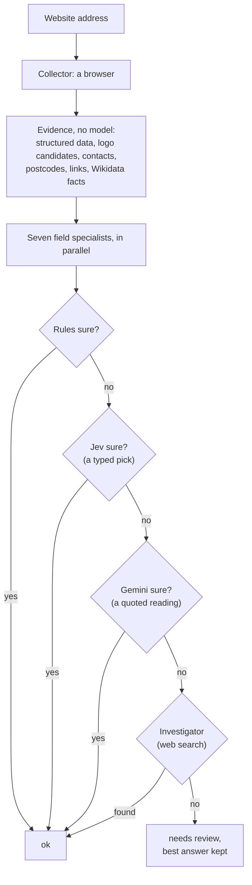

# Evidence first, models last

*Reading a business off its website for a fraction of a cent*

Banks see thousands of merchants a day. Each needs a name, a logo, a merchant category code (MCC), a head-office address, a phone number, an email address and its social profiles, for onboarding, know-your-business checks, risk and transaction enrichment. Often all anyone has is a website address.

Business Insights v2 (bi2) takes that address and returns all seven, each with a status, a confidence and the evidence it rests on. It's open source, runs on your own machine with your own keys, and on its test sites costs under a tenth of a cent a site. This is how it's built, and what we measured.

## What v1 taught us

The first version worked the way most LLM prototypes do: it loaded the page, cleaned the HTML, and sent it to a model with a long prompt. Looking at it closely, five things stood out.

- **Most of the tokens were markup.** A homepage's cleaned HTML ran from 4,000 to 104,000 tokens. Its visible text was 17 to 159 times smaller.
- **Free answers were thrown away.** Every sampled homepage embedded schema.org data with its logo, and one had its address, phone and opening hours too. The HTML cleaner deleted every `<script>` tag, and the structured data with it.
- **The MCC rules were biased.** Keywords matched substrings, so "eat" matched "great" and "menu" matched every navigation bar. Most sites came out as restaurants.
- **Failures looked like answers.** A failed MCC call became 5812, "restaurant", marked as a success.
- **Nothing could be measured.** There was no ground truth and no tests.

So v2 started with a gold set of 56 sites with checked answers, and a test set of 166 more that no rule is ever tuned on, and every change since has been measured against them.

## The design in one sentence

**Collect the evidence once, with no model, then climb a ladder of answerers, from free rules to a typed-decision model to an LLM to a web search, stopping at the first one that's sure.**

Five rules hold the design together:

1. **Models never see raw HTML.** They see a few labeled lines of evidence, chosen for the one question they're asked.
2. **The cheapest source that can answer, answers.** Escalation happens only on missing data, disagreement or low confidence.
3. **Typed in, typed out.** Every stage passes Pydantic models, and every model call has a schema.
4. **No silent defaults.** Each field ends as `ok`, `needs_review`, `not_found` or `error`. Nothing is guessed.
5. **Show the source.** Each field records every step that ran, why it passed the question on, and what it cost.

## Two kinds of model

Most of what bi2 asks a model isn't open-ended. Is this numbered box the logo? Which of these five names is the business's? Which of these three numbers is the main one? Which of these 319 codes fits? Those are *decisions*, and a generative LLM is an expensive, slow and occasionally inventive way to make them.

bi2 sends decisions to [Jev](https://docs.typesafe.ai), TypeSafe's "System One" model. Jev takes a state and typed questions (pick one, yes or no, rate, or find in an image) and returns a probability for every answer. It never writes text, so it can only pick from the options it was given. Whatever it picks is one of the rules' own candidates, so it can't invent a phone number. On our runs it answered in 0.2 to 0.6 seconds, at a list price of about $0.04 a million input tokens.

Generation goes to Gemini, for the few things that are genuinely generative: reading a business name out of a logo, or an address out of a contact page whose format no rule knows. Gemini has to quote the evidence, and code checks that the quote is on the page and the answer is in the quote. A name the page doesn't show is refused.

## Four patterns that made it work

**A numbered screenshot for logos.** The browser records every image's position. bi2 draws the likeliest candidates as numbered boxes on the screenshot and asks Jev which number is the business's logo. The options are listed top to bottom, not in the rules' ranking, so the model can't simply agree with the rules. When Jev and the rules pick the same box, the answer is sure. When they differ, Gemini gives a second opinion.

**Two rounds for 914 codes.** MCC has 914 codes, but 595 of them each name one chain, like 3009 for Air Canada. The other 319 are too many for one question (Jev takes up to 255 options), so they go in two lists, asked in one call. The leaders of both lists go to a final round with their descriptions. A chain code joins the final only when the business's name matches the chain's, and when Jev picks the chain's family, like any airline, the chain's own code replaces it.

**Ask again, reversed.** Jev's own documentation notes that it leans toward the first option. So when its final MCC pick is unsure, bi2 asks again with the options in the opposite order. The same pick both ways is a sure one. It's self-consistency for a few hundredths of a cent.

**One call for a site's questions.** The specialists run at once, and when several need Jev at the same moment, their questions wait for each other and go together, each with its own labeled evidence: Jev's fan-out pattern. They go when every specialist still running is waiting, so the same questions go together on every run and kept answers still match. The MCC's long first round goes on its own, since small questions read less well beside it.

**Cheapest first, even inside a step.** Before Gemini reads an address off a page, Jev answers a yes-or-no question: does this text give a street address at all? Most of the time it doesn't, and the slow call is never made.

## Programmatic sources first

Several answers need no model at all:

- **Structured data.** JSON-LD often states the business's name, logo, phone and address outright.
- **Wikidata.** Big brands list their official websites there, along with their logo files and head offices. Rogers' entry gives 333 Bloor Street East and its postcode, which rogers.com's homepage doesn't show. When a page blocks bots, Wikidata still answers.
- **The privacy policy.** It names the company that keeps your data, usually with its head office's address. When no other page gives a street address, bi2 reads that one page too, which found Home Hardware's head office in St. Jacobs and Indigo's on King Street West.
- **OpenStreetMap's Nominatim.** Every address gets map coordinates, and a flag when the map disagrees on its postcode. The published address is never replaced.
- **The logo file itself.** Its colors are the brand's: an SVG's fills, or a picture's main colors without its background.

## Agents, where they pay

The normal path is a fixed workflow. That's deliberate: banks need answers they can repeat and audit, and a workflow is cheap and testable. Agency appears only at the edges:

- **Specialists.** Seven field resolvers run in parallel, each its own cascade with its own evidence.
- **A decider and a generator.** Jev and Gemini, each behind a port, with Gemini as Jev's backup when Jev is down or its quota is used up.
- **An investigator.** The last step for a head office no page gives: a web search through Gemini's Google Search grounding, whose answer must cite the pages it found.
- **A budget.** Every site gets at most 12 model calls across every model, so one strange site can't use up a day's quota.

## Free tiers are a design constraint

bi2 was built against free API tiers, and they shaped it more than any benchmark did:

- Gemini 3.5 Flash's free tier allows **20 requests a day**. Flash-Lite allows more but took **15 to 60 seconds a call** on the free tier during our runs.
- Google Search grounding is **not available** on Gemini's free tier, so the investigator is skipped there, and the first refusal switches it off for the rest of the run instead of retrying in vain.

So every call takes a turn from a limiter that knows each model's requests per minute, per day and at once, and keeps the day's counts in a file across runs. When Google says a daily quota is used up, bi2 stops asking that model until midnight Pacific. Every answer is kept on disk, keyed by a hash of the question, its prompt version and the model, so a rerun on saved pages asks no model at all. That's what made it possible to run the gold set dozens of times in a day on free keys.

## The numbers

On the 56 gold sites' saved pages, so every run sees the same pages and only the code changes:

| Field | Rules only | With Jev and Gemini | Right and sure, rules | Right and sure, with models |
|---|---|---|---|---|
| Company name | 54 of 56 | **56 of 56** | 50 | **55** |
| Logo | 36 of 46 | 36 of 43 | 33 | **36** |
| MCC | not built | **55 of 56** | | 51 |
| Head-office address | not built | **31 of 47** | | 25 |
| Phone | 19 of 23 | 19 of 23 | 18 | 18 |
| Email | 42 of 45 | 42 of 45 | 21 | 22 |
| Social links | 37 of 37 | 37 of 37 | 37 | 37 |

The logo counts differ because three answers changed to other files of the same logo that nobody has checked yet. "Right and sure" matters as much as "right": every unsure answer costs a person's attention later. The models' main contribution is turning right-but-unsure answers into sure ones.

On the test set: 166 sites the rules were never tuned on, from Canadian chains, banks and crypto exchanges to small businesses in 26 countries, in their own languages. These count the answers a person or a drafted check against the site's own pages has verified:

| Field | Rules only | With Jev and Gemini | Right and sure, rules | Right and sure, with models |
|---|---|---|---|---|
| Company name | 110 of 116 | 110 of 116 | 94 | **106** |
| Logo | 99 of 116 | 100 of 116 | 86 | **95** |
| Phone | 115 of 133 | 115 of 133 | 83 | **93** |
| Email | 139 of 145 | 138 of 145 | 80 | **86** |
| Social links | 107 of 115 | 107 of 115 | 95 | 95 |
| MCC | not built | **143 of 149** | | **126** |

The models changed few answers but settled many: 37 more answers became sure across the five fields the rules already answered, each one an answer nobody has to look at. The MCC row is from drafted checks against each site's title and description, not yet confirmed by a person; ten answers too unclear to judge that way are left out. Of the six it gets wrong, three are sure: a jeweler filed as a wholesaler, a Colombian coffee roaster as a stationer, and a parked domain still filed as the cafe it used to be.

### What a site costs

The same calls priced on other providers' models, at list prices on 2026-10-20 (see [costs.md](../costs.md) for the method):

| Models | Per site, gold set | Per site, test set | Per 1,000 sites |
|---|---|---|---|
| **Jev + Gemini 3.5 Flash-Lite** (default) | **$0.00073** | **$0.00067** | **$0.67 to $0.73** |
| Gemini 3.5 Flash-Lite alone | $0.00347 | $0.00397 | $3.47 to $3.97 |
| Jev + Claude Haiku 5.5 | $0.00048 | $0.00050 | $0.48 to $0.50 |
| Claude Haiku 5.5 alone | $0.00111 | $0.00126 | $1.11 to $1.26 |
| Jev + GPT-5.4 nano | $0.00059 | $0.00057 | $0.57 to $0.59 |
| GPT-5.4 nano alone | $0.00225 | $0.00257 | $2.25 to $2.57 |
| Gemini 3.6 Flash alone | $0.00832 | $0.00945 | $8.32 to $9.45 |
| Claude Sonnet 5.5 alone | $0.02218 | $0.02521 | $22.18 to $25.21 |
| Claude Opus 5.5 alone | $0.04437 | $0.05041 | $44.37 to $50.41 |
| v1, estimated: page HTML in every call | about $0.04 | | about $40 |

bi2's default, Jev for decisions and Gemini Flash-Lite for the rare generation, costs **under a tenth of a cent a site**. Asking an LLM to make the decisions too costs 2 to 10 times more, for answers that come without probabilities. On the free tiers it costs nothing.

### How long a site takes

On 24 live sites, loaded in a real browser, with Jev alone (`--fast`) and every question new: **16.7 seconds a site, the median**, most of it loading the page and its contact page. Jev's own calls took 0.2 seconds, the median, and 2.8 of them a site.

All 166 test-set sites, live, three at a time, took **25 minutes: 9 seconds a site** of wall-clock time, for $0.066 at list price in all. Seven wouldn't load, behind bot checks.

Two things slow a run on the free tiers: Jev's calls wait their turn in its 20 a minute when many sites run at once, and Gemini's free tier took 15 to 60 seconds a call. On the 166-site test set, six sites at a time, a site took a minute, the median, almost all of it waiting for a turn. On paid tiers that wait goes away, and the page load is what's left.

## Built to be trusted

- **Layers checked by a tool.** Core types import nothing; logic never imports infrastructure; providers sit behind ports. import-linter fails CI when that breaks.
- **Typed everywhere.** mypy in strict mode, Pydantic models that reject unknown keys, and results that can't carry a value for a field marked not found.
- **Tests that need no keys.** Every model in the tests is a stand-in, so pull requests from forks, which get no secrets, run the same 385 tests.
- **A nightly live eval.** CI runs the gold set against the live sites and models, and fails when a field's accuracy drops below its floor or a site costs more than half a cent.
- **An MCP server.** `bi2 mcp` lets an AI assistant like Claude analyze a website, ask how any field was decided, and look up MCC codes, on the user's own machine and keys.

## What we'd tell anyone building this

1. **Measure before optimizing.** A gold set and a test set, with saved pages, made every claim in this post checkable.
2. **Most "AI" questions are decisions.** Give a decision model the candidates your rules found and let it pick. It's faster, cheaper, calibrated, and can't make things up.
3. **Make the LLM quote.** If an answer must come from the page, check that it does.
4. **Plan for the free tier.** Rate limits and daily quotas are part of the design, and so is caching every answer.
5. **Keep the agent on a leash.** A fixed workflow with escalation steps beats a free-roaming agent for anything a bank has to audit.

bi2 is MIT-licensed. Install it, add a Jev or Gemini key, and run `bi2 analyze https://example.com`.
