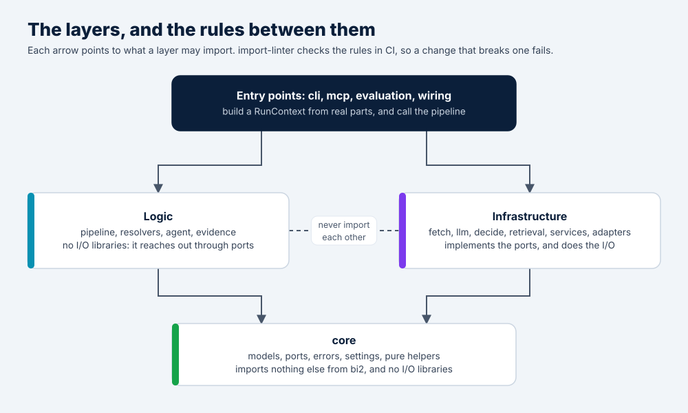

# Codebase guide

Status: updated 2026-10-20, with the model layer, the MCC, the address and the MCP server built. This is the companion to [architecture.md](architecture.md). That doc says what v2 does and why; this one says where code goes and how to write it.

## Goals

1. **Easy to understand.** A new contributor can find where anything lives, and the whole codebase follows the same few patterns.
2. **Easy to extend.** Adding a field, a model provider, a country or an output format means adding files, not editing the core.
3. **Easy to test.** Every test except the live eval runs without network access or API keys.
4. **Conventions are checked by tools.** Contributors don't have to memorize them, and reviewers don't have to police them.

## Lessons from v1

| v1 problem | v2 rule |
|---|---|
| `utils/` mixed unrelated things: the LLM client, config loading, URL-list loading and terminal colors | There is no `utils` folder. Helpers live in modules named after their topic. |
| The agents printed to the terminal themselves | Library code emits events and never prints. Only the terminal app and the server decide how to show progress. |
| A config singleton, with `.env` loaded when a module was imported | Settings are loaded once by the entry point and passed in. Environment variables are read in one file only. |
| Result dicts whose keys drifted between modules (`geocoding` vs `geocoding_result`, two location schemas) | Pydantic models between every stage, checked by mypy |
| Bare `except:` blocks and silent fallbacks | Typed errors that map to field statuses |
| A hard-coded list of allowed model names | A model registry data file, with aliases |
| `sys.path.append` in the entry points | An installed package with console-script entry points |

## Layers



- **`core`** imports nothing else from `bi2`.
- **Logic** never imports infrastructure. It reaches the outside world only through the interfaces ("ports") defined in `core/ports.py`, which it receives in the `RunContext`.
- **Infrastructure** never imports logic. Each module implements one or more ports.
- **Entry points** are the only code that imports both. They choose the implementations and wire them together, through `wiring.py`.

CI checks these rules with import-linter, so a pull request that breaks them fails.

Why it matters:
- Logic can be tested with fakes.
- The terminal app and the website share the logic unchanged.
- Swapping a provider never touches resolver code.
- The website can scale by adding workers, because the logic doesn't know where it runs.

## Package layout

```
src/bi2/
├── core/                   building blocks; imports nothing else from bi2
│   ├── models.py           Status, FieldResult, SiteResult, PageSnapshot, Evidence and its parts
│   ├── asking.py           what v2 asks models and what they answer: typed questions (Choice,
│   │                       YesNo, Levels, Locate) and their answers, and JSON prompts
│   ├── ports.py            interfaces for everything that does I/O
│   ├── errors.py           exception types, and the field status each one maps to
│   ├── settings.py         the config schema and loader; the only file that reads env vars
│   ├── providers.py        the LLM providers (data/providers.toml) and "provider:model" names
│   ├── events.py           progress events and the EventSink interface
│   ├── text.py             whitespace, accents, company-name normalization, name matching
│   ├── urls.py             URL normalization, registrable domain, same-site checks
│   ├── netsafety.py        which IP addresses may be fetched (pure; the DNS lookup is in fetch/)
│   ├── hashing.py          content hashes and stable cache keys
│   ├── money.py            token usage → cost, using the model registry
│   ├── aio.py              bounded concurrency, timeouts, retry with backoff
│   ├── clock.py            Clock interface, with real and fake clocks
│   └── context.py          RunContext: the settings and ports a run needs
├── data/                   shipped data files (see "Data files")
├── prompts/                one folder per prompt (see "Prompts")
├── evidence/               extract_* functions: page snapshot → Evidence
├── resolvers/              cascade.py, asking.py (what model steps share), and one module per
│                           field: name, logo, mcc, address, phone, email, social; known.py
│                           (Wikidata's answers) and checking.py (the checker)
├── agent/                  the investigator and its read-only tools
├── pipeline.py             fetch → evidence → resolvers → SiteResult, emitting events
├── fetch/                  Playwright and plain-HTTP fetchers, with the DNS safety check
├── llm/                    the LanguageModels: gemini.py, anthropic.py and openai_compatible.py (one
│                           client per API); clients.py (which client a model gets), routing.py (a
│                           backup on another provider, web searches to the search model),
│                           limits.py (free-tier limits), registry.py (data/models.toml)
├── decide/                 jev.py (the Decider), llm.py (an LLM standing in for Jev, and a
│                           Decider with a backup)
├── retrieval/              unused: the MCC is picked by Jev, with no embedding search
├── services/               wikidata.py (the knowledge base), nominatim.py (the geocoder)
├── adapters/
│   ├── local/              files, in-memory cache and rate limiter, keys from env or keychain
│   └── hosted/             Postgres store, Redis cache, limiter and queue, encrypted keys
├── wiring.py               builds a RunContext from real implementations: local and hosted
├── cli/                    Typer commands: analyze, review, eval (score, compare, check), config,
│                           doctor, keys, mcp, dev
├── mcp/                    the MCP server (installed with the `mcp` extra)
└── server/                 FastAPI app, accounts, worker (later, with the `server` extra)
```

Each package's `__init__.py` starts with a docstring saying what belongs in it and what doesn't, so the answer to "where does this go?" is in the code itself.

## Where shared helpers go

- **A helper lives next to the only code that uses it.** Move it into `core/` when a second package needs it, and only if it is pure (no I/O).
- **Helpers that do I/O** belong with the infrastructure they serve, for example the shared HTTP client in `fetch/`.
- **Modules are named after their topic** (`text.py`, `urls.py`), never `utils.py`, `helpers.py` or `misc.py`.

The core helpers v2 starts with:

| Module | Functions |
|---|---|
| `text.py` | `clean_space(s)`, `fold(s)` (case and accents removed, for comparing), `normalize_company_name(s)` (drops legal suffixes such as Inc. and Ltd.), `names_match(a, b)` |
| `urls.py` | `normalize_url(url)`, `registrable_domain(url)` (`shop.example.co.uk` → `example.co.uk`), `domain_name(url)` (→ `example`), `same_site(a, b)`, `absolute_url(base, href)` |
| `netsafety.py` | `is_public_address(ip)` |
| `hashing.py` | `content_hash(data)`, `cache_key(namespace, **parts)` |
| `money.py` | `cost_usd(model, usage)` |
| `aio.py` | `gather_limited(tasks, limit)`, `with_timeout(task, seconds)`, `retry(call, policy)` (honors a provider's retry-after) |
| `errors.py` | `is_retryable(exc)`, `status_for(exc)` |

## The RunContext

Everything a run needs from the outside world travels in one object. The entry point builds it and passes it explicitly. There are no global singletons and no API clients created at import time.

```python
@dataclass(frozen=True)
class RunContext:
    settings: Settings
    fetcher: Fetcher  # Playwright + plain HTTP, with URL safety checks
    llm: LLMGateway  # every model call goes through here: cost log, cache, retries
    decider: Decider  # JevDecider or LLMDecider, chosen by the available keys
    codes: CodeSearch  # MCC vector search
    search: SearchClient | None  # None when there is no SerpAPI key
    geocoder: Geocoder
    cache: Cache
    limiter: RateLimiter
    store: ResultStore
    events: EventSink
    clock: Clock
```

- `RunContext` lives in `core/context.py`, so resolvers can use it without importing infrastructure.
- The builders live in `wiring.py`. The terminal app calls `build_local_context(settings)`, and the website's worker calls `build_hosted_context(settings, job)`.
- A test builds one from fakes in a couple of lines.

## Function conventions

**There are three kinds of functions, named by what they do:**

| Prefix | Does | Example |
|---|---|---|
| `extract_*` | Pure: turns a page snapshot or text into typed data, with no I/O | `extract_logo_candidates(snapshot) -> list[LogoCandidate]` |
| `resolve_*` | Runs one field's cascade, using ports from the context | `resolve_mcc(evidence, ctx) -> FieldResult[Mcc]` |
| `fetch_*` and adapter methods | Does I/O, behind a port | `fetch_page(url) -> PageSnapshot` |

**Every field follows the same recipe.** A resolver is a list of steps handed to one shared helper:

```python
async def resolve_name(ev: Evidence, ctx: RunContext) -> FieldResult[CompanyName]:
    return await run_cascade(
        "company_name",
        steps=[names_from_free_sources, names_by_decider, names_by_llm],
        ev=ev,
        ctx=ctx,
    )
```

Each step returns either `Resolved(value, confidence, source, evidence)` or `Escalate(reason)`. `run_cascade` handles the rest the same way for every field:

- It accepts the first answer whose confidence clears the configured threshold, and the field is `ok`.
- It keeps the best answer that falls short. If no answer clears the threshold, the field is `needs_review` with that best answer, so the analyst has a starting point.
- If no step finds anything, the field is `not_found`.
- A provider error is recorded and the next step runs. If every step fails, the field is `error`, never a guessed default.
- It records which steps ran, what each one cost, and why each one escalated. This becomes the field's audit trail.

**Other rules:**
- **Typing.** Type hints everywhere, checked by mypy in strict mode, and Pydantic models at every boundary between stages.
- **Errors.** Errors are raised as the types in `core/errors.py`. Only `run_cascade` and the pipeline turn them into statuses.
- **No printing.** There is no `print` in library code (enforced by ruff). Progress goes out as events, such as `StageFinished(site, stage, seconds, status)`, and the terminal app or the server decides how to show them.
- **Environment variables** are read only in `core/settings.py` (enforced by ruff's banned-API rule).
- **Documentation.** Every public function has a one-line docstring, and comments explain why, not what.
- **Size.** Aim for about 50 lines per function and 300 per module. Past that, split it.
- **No clever metaprogramming.** Registries are plain dictionaries you can read.

## Extension points

Most contributions should mean adding files plus one registry line:

| To add | You create | You register it in |
|---|---|---|
| A field | A model in `core/models.py`, a resolver, its prompts, gold-set labels | `resolvers/__init__.py` |
| An LLM provider that speaks OpenAI's chat API | Nothing: an entry is enough | `data/providers.toml`, and its prices in `data/models.toml` |
| An LLM provider with its own API | A client in `llm/`, like `anthropic.py` | `client_for` in `llm/clients.py`, the `api` values in `core/providers.py` |
| A search or geocoding provider | An adapter implementing the port | `services/__init__.py` |
| A country | Its names, domains, main languages, postcode format and provinces | `data/countries.toml` |
| A platform (Pinterest, Yelp and so on) | Its domains and profile URL patterns | `data/platforms.toml` |
| An output format | A writer | `cli/output.py` |
| An interactive command | A handler function | The command table in `cli/interactive/commands.py` |

Each of these gets a step-by-step guide in `docs/recipes/`. Third-party plugins through Python entry points can come later, if people ask for them.

## Configuration

**There is one schema.** A pydantic-settings model in `core/settings.py` defines every setting, with its type, default and documentation. Config files are TOML, which Python reads natively and which `pyproject.toml` already uses.

**Settings come in layers, lowest priority first:**
1. Defaults in the schema
2. The user's config file, `bi2.toml` in the user's config folder, for every folder they run v2 in. The folder is the one Typer's `get_app_dir` gives, so it's right on Windows, macOS and Linux.
3. The project's file, `./bi2.toml`, for team or CI settings, or the file `BI2_CONFIG` names
4. Environment variables: `BI2_` and the setting's path, with `__` between levels, like `BI2_AI__LLM_MODEL` or `BI2_PROVIDERS__OLLAMA__BASE_URL`. An empty one counts as unset, like a CI input left blank.
5. Command-line flags, which change only what they say, so a flag left out never undoes a config file

**Example config file:**

```toml
[ai]
llm_model = "anthropic:claude-haiku-5-5"   # "provider:model"
backup_model = "gemini-flash-lite-latest"  # a listed model can go by its name alone; "none" for none
search_model = "gemini-3.5-flash"          # where web searches go; only Gemini searches here
temperature = 0.0
timeout_s = 90                             # how long one model call may take
jev = true                                 # Jev makes the typed choices when its key is set
calls_per_site = 12                        # the most model calls one site may make
daily_share = 0.9                          # the share of each free tier's day v2 may use

[thresholds]
accept = 0.85                              # confidence needed to accept an answer

[providers.ollama]                         # a provider's fields, changed one by one...
base_url = "http://gpu-box:11434/v1"

[providers.office]                         # ...or a new one: any server that speaks OpenAI's API
title = "Our gateway"
base_url = "https://llm.example.internal/v1"
keys = ["OFFICE_LLM_KEY"]

[models."office:llama-3.3-70b"]            # a model's own prices and limits
input_per_million = 0.0
per_minute = 300
```

**Keys are never in config files**, because config files often get committed or shared. The terminal app looks for each key in two places, in this order:
1. The provider's usual environment variables, which `data/providers.toml` lists: `GEMINI_API_KEY`, `ANTHROPIC_API_KEY`, `OPENAI_API_KEY` and so on, and Jev's `JEV_API_KEY`. This is what CI, Docker and servers use.
2. The operating system's keychain: macOS Keychain, Windows Credential Manager, or Secret Service on Linux. `bi2 keys set <provider>` saves a key there, and `bi2 config` offers to when a provider has none. Where there's no keychain, as on most headless servers, use the environment variables.

There is no automatic `.env` loading, because a `.env` file in a project folder is easy to commit by accident. `bi2 doctor` shows where each key was found, with all but the last four characters hidden.

**The website** uses the same schema, with its settings taken from environment variables: database and Redis URLs, OAuth client IDs, free tries per account, the free-try daily cap and the shared-result reuse window.

**Two helper commands:**
- `bi2 config` chooses the provider, the model and any settings with the arrow keys, and saves them in the user's file or the project's. It never writes a key to a file.
- `bi2 config show` prints every setting and where it came from: the default, the user's file, the project's file or the environment.

## Model registry

Two data files are the one place that knows about specific providers and models:

- `data/providers.toml`: each provider's API (`openai`, `anthropic` or `gemini`), its address, the environment variables its key may be in, and the models to suggest. Most providers speak OpenAI's chat API, so adding one is an entry here.
- `data/models.toml`: each model's list prices and the limits v2 keeps it under, by provider.

```toml
# data/providers.toml
[groq]
title = "Groq"
base_url = "https://api.groq.com/openai/v1"
keys = ["GROQ_API_KEY"]
json = "object"              # it's asked for a JSON object, since it refuses JSON schemas

# data/models.toml
[anthropic."claude-haiku-5-5"]
input_per_million = 0.10     # US dollars, at list price
output_per_million = 0.50
per_minute = 50
per_day = 10000
at_once = 4
```

- A model is named `provider:model`. One that `models.toml` lists, or whose name says whose it is (`gpt-`, `claude-`, `gemini-`, `mistral-` and so on), can go by its name alone, as in v1. `core/providers.py` reads the names.
- A model that isn't listed still runs, with modest limits and no price, until a config file's `[models."provider:model"]` gives it its own.
- Three clients speak the three APIs: `llm/gemini.py`, `llm/anthropic.py` and `llm/openai_compatible.py`. `llm/clients.py` picks the one for a model, and `llm/routing.py` chains a backup on another provider and sends web searches to the search model.
- The OpenAI-compatible client asks for a JSON schema first and steps down to a JSON object, then plain text, when a provider refuses; it also drops a setting a model refuses, like the temperature on a reasoning model. That's how one entry fits so many providers.
- When a provider retires a model or changes its prices, one file changes, followed by an eval run.
- `bi2 doctor` checks that each configured model's provider takes its key and lists the model for it.

## Data files

Data files ship inside the package and are loaded with `importlib.resources`, so they work after `pip install`:

| File | Contents | Updated how |
|---|---|---|
| `mcc_codes.csv` | The 914 codes and descriptions, from v1 | By hand, rarely |
| `mcc_synonyms.toml` | Plain-language terms for each code ("taproom" and "brewpub" for 5813) | By hand, followed by an eval run |
| `mcc_vectors.npy` + `mcc_vectors.json` | Embeddings of the codes plus synonyms, with the embedding model's name and a checksum of the inputs | Rebuilt by a dev command. CI fails if the checksum doesn't match the inputs. |
| `schema_types.toml` | schema.org business types → likely MCC codes | By hand |
| `models.toml` | Each model's prices and the limits v2 keeps it under, by provider | When providers change models or prices |
| `providers.toml` | Each LLM provider's API, address, key variables and suggested models | When a provider is added or moves |
| `countries.toml` | Each country's names, domains, main languages, postcode pattern and provinces | By hand; adding a country is one entry |
| `legal_suffixes.txt` | Inc., Ltd., LLC, GmbH, S.A. and so on | By hand |
| `platforms.toml` | Platforms where businesses have pages (Pinterest, Instagram, Yelp, TripAdvisor…), with their profile URL patterns | By hand; adding a platform is one entry |

Each file carries a version, and every result records the versions it was produced with.

## Prompts

- Each prompt has its own folder, for example `prompts/mcc_tiebreak/`, holding two files:
  - `prompt.md`: the template, with labeled evidence sections
  - `meta.toml`: version, output schema, temperature and token limit
- Templates use plain `{placeholders}`, not a template engine.
- The prompt version goes into the LLM-call log and into the result.
- Changing a prompt means a new version and an eval run, and the pull request shows the before-and-after scores.

## Output contract

- Every JSON result carries a `schema_version`, so people who build on the terminal app's output know when it changes.
- A breaking change bumps the major version and is listed in the changelog.
- CSV output has one row per site and four columns per field: `<field>`, `<field>_status`, `<field>_confidence` and `<field>_source`.

## Tests

| Kind | What it covers | Needs network or keys? |
|---|---|---|
| Unit | Pure functions: `core` helpers, `extract_*` functions on saved HTML fixtures, `run_cascade` with fake steps | No |
| Contract | One shared test suite per port, run against every implementation (for example both the local and the Redis cache) | No (Redis runs in a container) |
| Replay | The whole pipeline, on synthetic test pages with recorded model responses | No |
| Interactive | The session's command handlers, and its screens captured with Rich's recording console | No |
| Eval | The gold set, against live sites and models | Yes. It runs nightly with the project's keys, and on pull requests that change prompts, models or thresholds when a maintainer triggers it. |

A contributor can run everything except the eval right after cloning.

**Test pages are synthetic.** We write small HTML pages that reproduce the tricky patterns found on real sites: JSON-LD blocks, lazy-loaded and inline-SVG logos, several versions of a logo, footer addresses, cookie banners and so on. They are our own work, so they can be published under the project's license. The repository never contains copies of third-party websites:
- The gold set stores URLs and the expected answers (names, codes, addresses, logo URLs), not page content or images.
- The nightly eval fetches the live sites and publishes scores only.
- Maintainers can keep page snapshots on their own machines for debugging. The snapshot folder is git-ignored.

## Dependencies

Each dependency is here for a reason, and anything new needs one too.

| Package | Why |
|---|---|
| pydantic, pydantic-settings | Typed models and the layered config |
| httpx | Async HTTP for plain fetches, SerpAPI and Nominatim |
| playwright | Rendered pages, element positions and screenshots |
| typer, rich | Terminal app commands and display |
| keyring | Saving keys in the operating system's keychain |
| prompt_toolkit | The interactive session's input line: history, completion of `/` commands and multi-line paste, on Windows, macOS and Linux |
| selectolax | Fast HTML parsing with CSS selectors, for evidence extraction (Python's own parser can't select elements) |
| pillow | Shrinking screenshots before they go to a model, drawing numbered boxes for the logo question, detecting real image types |
| phonenumbers | Reliable phone parsing, and country hints from phone numbers |
| tldextract (with its bundled suffix list) | Correct registrable domains (`.co.uk`, `.com.au`) |
| opentelemetry-api | Tracing hooks; an exporter is optional |
| Extra `mcp` | The MCP server (`bi2 mcp`), through the official SDK |
| Extra `server` (build phase 4) | FastAPI, uvicorn, the Postgres and Redis clients, the OAuth library |

Jev and the LLM providers need no packages of their own: all are called over their REST APIs with httpx, through three small clients, one for Gemini's API, one for Anthropic's and one for OpenAI's, which most other providers speak too. The MCC is picked by Jev, so there's no embedding model either.

**Dev tools:**
- uv: environments and the lockfile
- ruff: linting and formatting
- mypy: strict type checking
- pytest, with pytest-asyncio
- import-linter: the layer rules
- pre-commit hooks that run the same checks as CI

**Considered and not needed yet:**
- **extruct:** JSON-LD and OpenGraph are simple to parse ourselves. Add extruct only if microdata turns out to matter on the gold set.
- **rapidfuzz:** the standard library's `difflib` is fast enough for a handful of names.
- **LiteLLM:** our own small gateway keeps structured output, cost logging and caching under our control.
- **Jinja2:** plain placeholders are enough.

## Keeping it healthy

- **Model changes:** edit `data/models.toml`, run the eval, and note the change in the changelog.
- **MCC data changes:** edit the codes or synonyms, rebuild the vectors, and run the eval.
- **New fields:** follow `docs/recipes/adding-a-field.md`, which lists the model, resolver, prompts, gold labels, eval metric and output columns to add.
- **Releases:** semantic versioning and a changelog. Each release lists its prompt, data and output-schema versions.
- **Contributor docs:**
  - README for users
  - CONTRIBUTING for setup and the checks
  - this guide for structure
  - recipes for common changes
  - issue and pull-request templates

## Open questions

- Command and package name (`bi2` is a placeholder).
