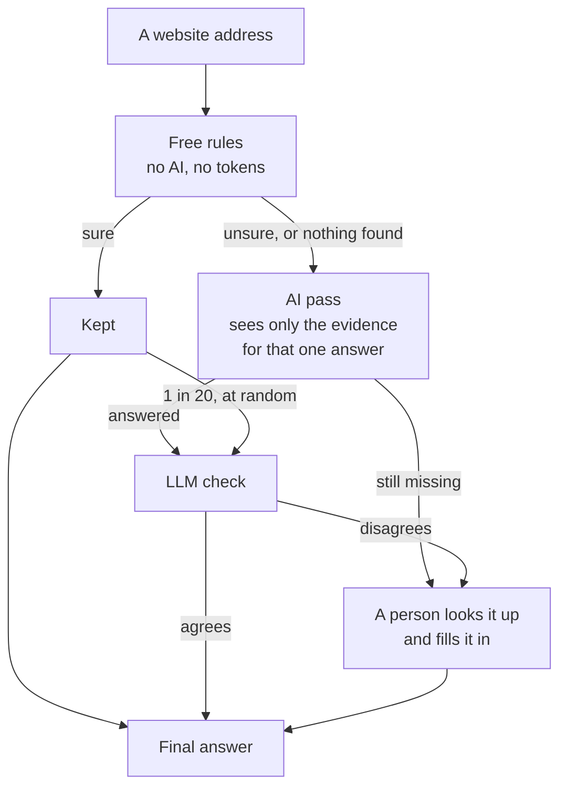
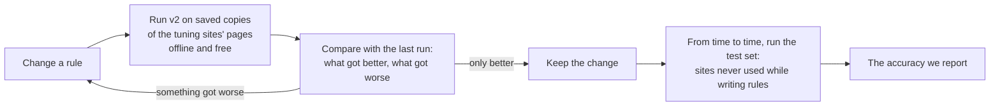

# Plan: accurate answers, from free rules to AI to a person

Agreed on 2026-10-12. This plan covers how v2 gets each field right without manual work: first with free rules, then with AI for the answers the rules are unsure of, and only then with a person for what's still missing. It also covers how we prove the accuracy at each step. The progress review it builds on is [reviews/2026-10-12.md](../reviews/2026-10-12.md).

## 1. The goal

- **The target:** for each field, across a whole sample of sites, 95–98% of the free rules' answers are right. An answer counts when it's right, even if v2 marked it unsure.
- **Also:** push up the share of answers that are right *and* sure. Each unsure answer costs an AI call later.
- **Then:**
  1. An AI pass for the unsure answers.
  2. An LLM check of the results.
  3. A person only for what's still missing.

## 2. Where we are

On the 56 gold-set sites, with no AI:

| Field | Right | Right and sure | Main gaps |
|---|---|---|---|
| Social links | 36 of 37 (97%) | 36 (97%) | |
| Company name | 52 of 56 (93%) | 48 (86%) | Pages that block us; a name shown only inside the logo |
| Logo | 41 of 48 (85%) | 35 (73%) | Logos the page reader misses; blurry screenshot crops |
| Phone | 19 of 23 (83%) | 18 (78%) | Numbers on a page v2 doesn't open |
| Email | 42 of 45 (93%) | 21 (47%) | Addresses for one purpose that their names don't give away; right ones left unsure |
| Address, MCC | not built yet | | |

- Logos, phones and social links count only the sites where the gold set or your checks say what the right answer is.
- These figures come from one live run, and the phone and email rows from a run on the saved pages on 2026-10-13. Live runs move a few points, because sites change between visits and some block us only now and then.

## 3. The pipeline

- An answer the rules are sure of is kept as it is. A random 1 in 20 also goes to the LLM check, to catch rules that start to slip.
- Each step is measured the same way before the next one is built: on the review page, with the four groups (kept and right, kept but wrong, sent on but right, sent on and wrong).
- Answers people fill in also become test answers, so the tests grow from real work.

## 4. How we measure

- **Two sets of sites:**
  - A tuning set we write rules against: today's 56, growing as we go.
  - A test set of about 200 new sites that we never look at while writing rules. With 200 sites, a result is accurate to about ±3 points; with 56, a single site moves it by 2.
- **The test set matches what bank teams see:** restaurants, retail, services, online shops, high-risk businesses such as gambling and crypto, profiles on platforms, and sites that block bots.
- **Saved copies of the pages,** so every run sees the same pages and only the rules change. The copies stay on our machines, since copies of other sites never go in the repository. A live run each week catches sites that have changed.
- **Every run is compared with the last** and lists each answer that got better or worse.
- **Checks that last.** When you mark an answer wrong on the review page, you'll be able to give the right one, or pick the right logo candidate. It becomes a test answer, so it still counts after the rules change.
- **Who does what:** I draft the test sites and v2's first answers, and you check them on the review page. For an answer that's right, that's one click.
- **So far:** 166 test sites are in `eval/test-set.toml`.
  - 57 are mostly Canadian, from coffee chains and banks to crypto exchanges, a vape shop and profiles on platforms.
  - 64 are small businesses in 26 countries, with sites in their own languages.
  - 45 are sites v2 had never seen, picked before looking at their contact details, to measure the phone and email rules on new sites. Only their phones and emails are checked so far.

  Sites that time out or block the browser count as failures, since they're part of the sample too. Every answer is checked, either by you or by a drafted check against the site's own pages (see eval/README.md). The exceptions are 50 answers that couldn't be verified, mostly phones and emails not shown on the pages v2 reads, and the third batch's names, logos and social links, which aren't checked yet.
- **The first score on the test set,** on 2026-10-13, with no AI:

  | Field | Right | Right and sure | Sure but wrong |
  |---|---|---|---|
  | Names | 108 of 121 (89%) | 76% | 3 of 95 |
  | Logos | 107 of 121 (88%) | 72% | 1 of 88 |
  | Social links | 105 of 120 (88%) | 78% | 4 of 97 |
  | Phones | 55 of 93 (59%) | 53% | 0 of 49 |

- **After step 1's phone and email work,** on 2026-10-13, with no AI. Names, logos and social links didn't change.

  | Field | Right | Right and sure | Sure but wrong |
  |---|---|---|---|
  | Phones | 78 of 98 (80%), from 55 of 98 | 63%, from 50% | 1 of 63 |
  | Emails, a new field | 95 of 105 (90%) | 51% | 0 of 54 |

  - The phone figures before are counted the new way: 5 more answers are checked now, since their sites' contact pages showed numbers v2 had missed.
  - Every phone and email still wrong is one of these:
    - a page that blocked us, wouldn't load or was a country picker
    - a platform profile that doesn't show it
    - a number read as the wrong country's: Coffee Supreme's, where a product code looked like an Irish postcode
    - an address for one purpose that its name doesn't give away: Drop Coffee's wholesale one, Wealthsimple's for group savings
    - numbers on a page v2 doesn't open, or only in text the page hides (7 sites)
  - **A caveat:** the email rules were written while looking at these sites' answers, since email was new and no site had a checked email yet. So these email scores show how well the rules fit these sites, not how they do on new ones. The third batch measures that.

- **On the third batch,** 45 sites v2 had never seen, with the rules unchanged:

  | Field | Right | Right and sure | Sure but wrong |
  |---|---|---|---|
  | Phones | 32 of 39 (82%) | 44% | 0 of 17 |
  | Emails | 35 of 41 (85%) | 51% | 1 of 22 |

  - That's close to the scores above, so the rules hold on new sites.
  - Five misses are pages v2 couldn't read: a bot check, two country pickers, and two sites that wouldn't load.
  - Two are rule gaps, for the next round:
    - Bettys: v2 took its press page for its contact page, and kept the press officer's address.
    - Kee Wah: its Hong Kong numbers weren't read, since Hong Kong isn't among the 35 countries yet.
  - One bug it found is fixed: an address like enquiries@ is plainly general now, where it was left unsure.

- **Pages that wouldn't load,** tried on 2026-10-13 in Playwright's Chromium, Chrome and Edge, headless and in a visible window:
  - 6 bot checks blocked every one of them, so other browsers aren't worth building.
  - Canadian Tire and Sport Chek load in any full browser; only the fast shell gets stalled. Pages that time out in the shell now load again in a full browser.
  - Bengawan Solo's certificate is for its name without "www.". A site whose certificate is for its other name now loads under that one.
  - With these three loading, the test set's names, logos and social links each gain 2 right answers, and phones and emails 2 and 3. One is wrong: Sport Chek's structured data gives its parent Canadian Tire's number, not its own.

## 5. Step 1: the rules, field by field

| Field | Fix | Sites from the review it fixes |
|---|---|---|
| Logo | Save logos written as SVG code as that code, not as a screenshot crop | Red Cross (dimmed by a pop-up), Best Buy and Bellwoods (blurry) |
| Logo | Find the logos the page reader misses: look at the header first, keep small images that link home, read CSS masks, wait for the header to appear, crop logos that are only styled text | Waterstones, Mejuri, Warby Parker, Air Canada, Uber |
| Logo | Take the largest size of the logo the site offers | Bellwoods, and sharper logos in general |
| Phone | When the homepage shows no number, load the contact page v2 already found. Done on 2026-10-13, for emails too | Get Well, Old Flame, Coinbase |
| Phone | Read numbers the way the site's country writes them, for more countries and for pages in a country's main language. Done on 2026-10-13 | Fritz (Korea), Hiiragiya (Japan) |
| Email | A new field: the business's general address, from the homepage or its contact page, never one for one purpose. Done on 2026-10-13 | |
| Phone, email | Never take a page for one purpose, like press enquiries or franchising, as the contact page, and count a link's text as much as its address. Done on 2026-10-13: tuned on the gold set's MEC, OLG and Indigo, it changed 12 test-set picks. Test-set phones went from 112 to 115 right and emails from 133 to 139, and no email the rules are sure of is wrong now | Bettys, Pizza Pizza (test set) |
| Phone | More countries, starting with Hong Kong, and check that a postcode clue isn't a product code. Find gold-set sites like these first | Kee Wah, Coffee Supreme (test set) |
| Phone | Handle sites that show a different number on each visit | Flight Centre |
| Name | When the page never states the name, offer the words in the domain as an unsure name | The Only Cafe |
| All | When a page blocks us, look big brands up on Wikidata, which is free and lists official names and logo files. A visible browser window was tried on 2026-10-13 and got past no bot check | Loblaws, Shoppers, Roots (blocked on some visits) |
| All | When a platform profile is walled off, use the business's own website instead | Bellwoods' Instagram (19+ wall) |
| Address | Build it: structured data first, then the footer and the contact page (postcode, city and house number). Homepages alone hold the address only a third of the time | not built yet |
| MCC | Build it: match the business's kind, from its structured data and page words, against the 914 MCC descriptions with a local search, with no AI. Unsure ones go to the AI pass | not built yet |
| Risk | Flag a site that redirects to a different business | Grace O'Malley's (now a gambling site) |

Already done on 2026-10-12:
- Logos now come from the browser's own copies, which fixed 6 sites whose servers refused a separate download.
- Stand-ins for a missing image are never taken as the logo.

**When step 1 is done** (to agree with you):
- On the test set, each field is at least 95% right.
- Answers v2 marks sure are almost never wrong: at most 1 in 100.

## 6. Step 2: the AI pass

Built after step 1 is done, and designed with you first.

- **What it sees:** only the unsure or missing answers, each with the evidence v2 already has, never the whole page. For a logo, that's the screenshot with numbered candidates. For a name or an address, it's the snippets of page text and structured data.
- **What it may answer:** it picks one of the candidates, or quotes the page. Code checks that the quote is really there, so it can't make an answer up.
- **How it's measured:** the same way as the rules, plus the tokens and money spent on each site.
- **Jev:** typed decisions with Jev get tried here, once we have access. Jev answers typed questions such as "which of these numbered candidates is the logo?", and the right answers you give on the review page, like a logo's candidate number, are what its answers will be measured against.

## 7. Step 3: the LLM check

1. First, measure how often the checker agrees with your checks. Use it only if it agrees almost every time.
2. Then it checks every AI answer, and 1 in 20 answers the rules were sure of.
3. Where it disagrees, the answer goes to a person.

## 8. Step 4: a person, for what's left

- Anything still missing or unsure after the AI pass is marked "needs a person", along with what was tried and the evidence.
- The review page doubles as that work list: the person fills in the answer there, and it becomes a test answer.

## 9. Order of work

1. **Repeatable tests.** Done on 2026-10-12:
   - saved copies of every gold site's pages, and of the first test sites
   - `bi2 eval compare`, which says what got better or worse between two runs
   - the review page taking the right answer when one is wrong

   A second run on the saved pages gave the same answers as the first.
2. **Rule fixes:**
   - logos (SVG code, and the logos the reader misses)
   - phones from the contact page
   - names from the domain
   - retries for blocked pages
3. **The test set:** I draft about 200 sites and v2's answers, and you check them.
4. **Address, then MCC.**
5. **Check step 1's targets on the test set,** then design the AI pass with you.

## 10. Open questions

- Should the test set cover only Canadian businesses, or the US and UK too?
- Is Wikidata fine as a free outside source for big brands' names and logos?
- Jev access, still pending.
