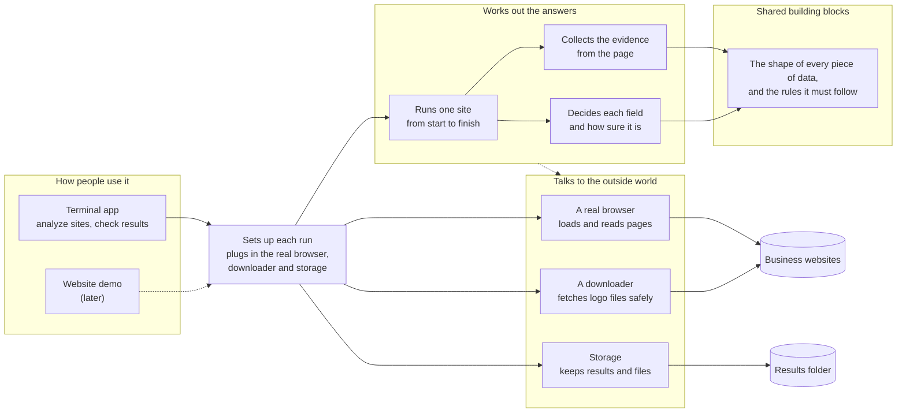
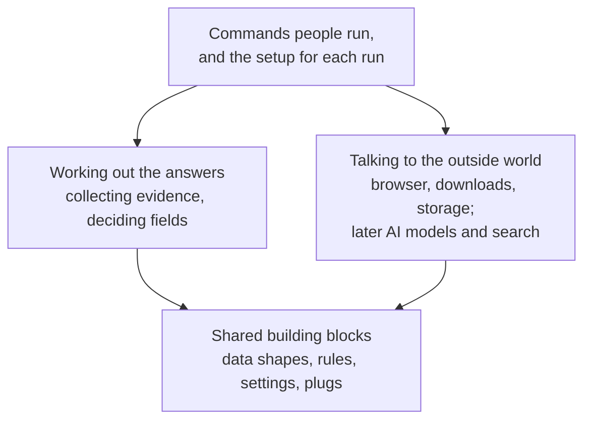
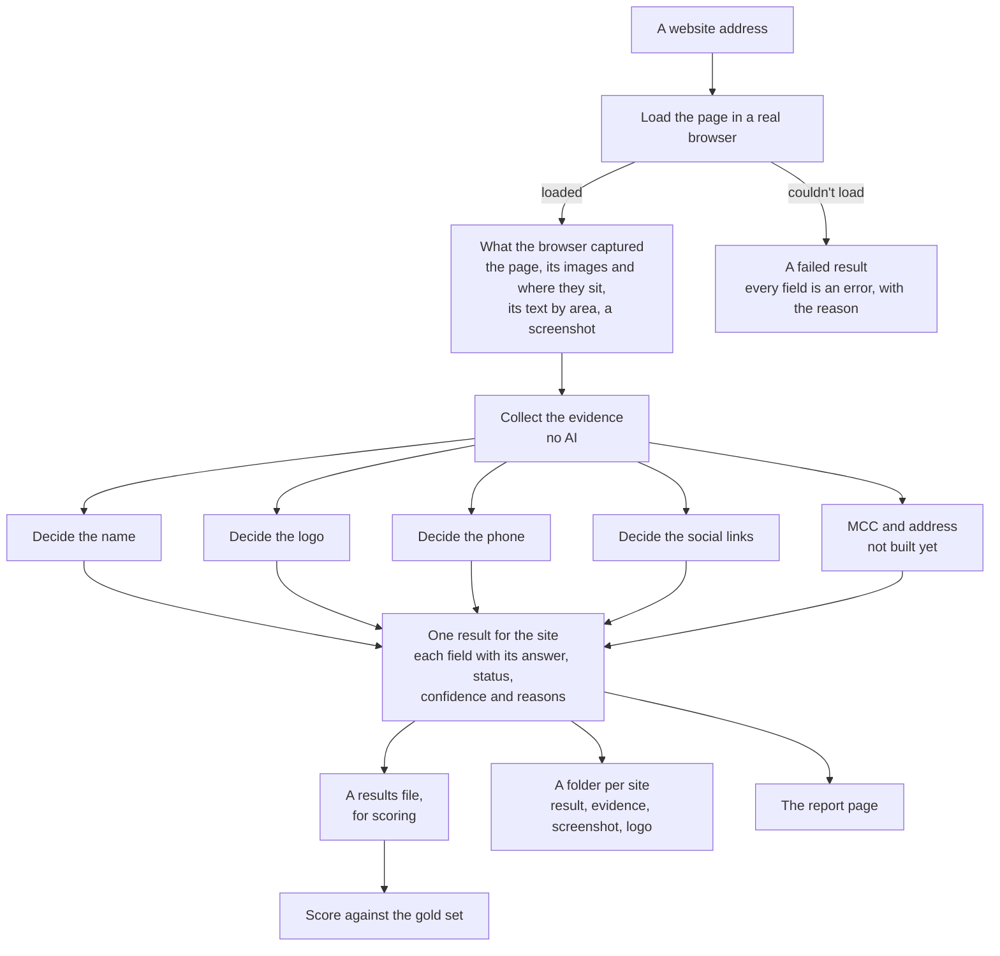
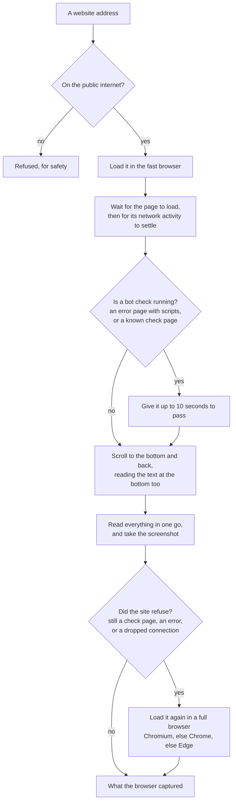
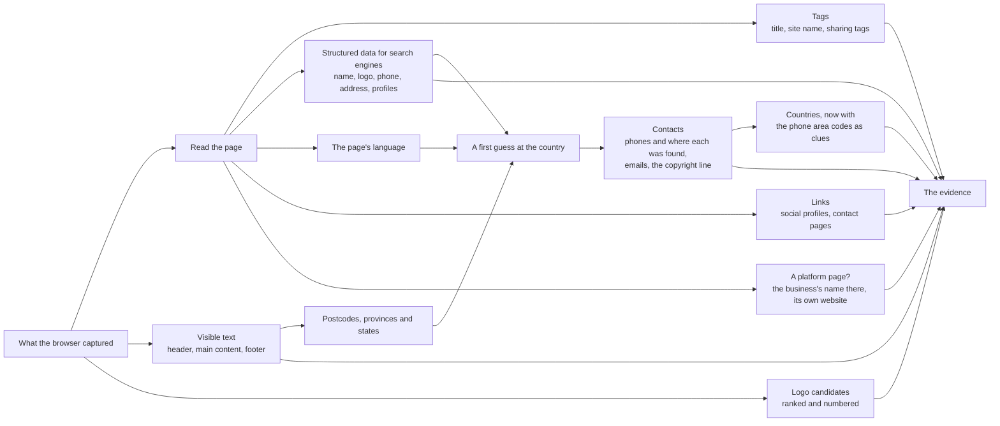
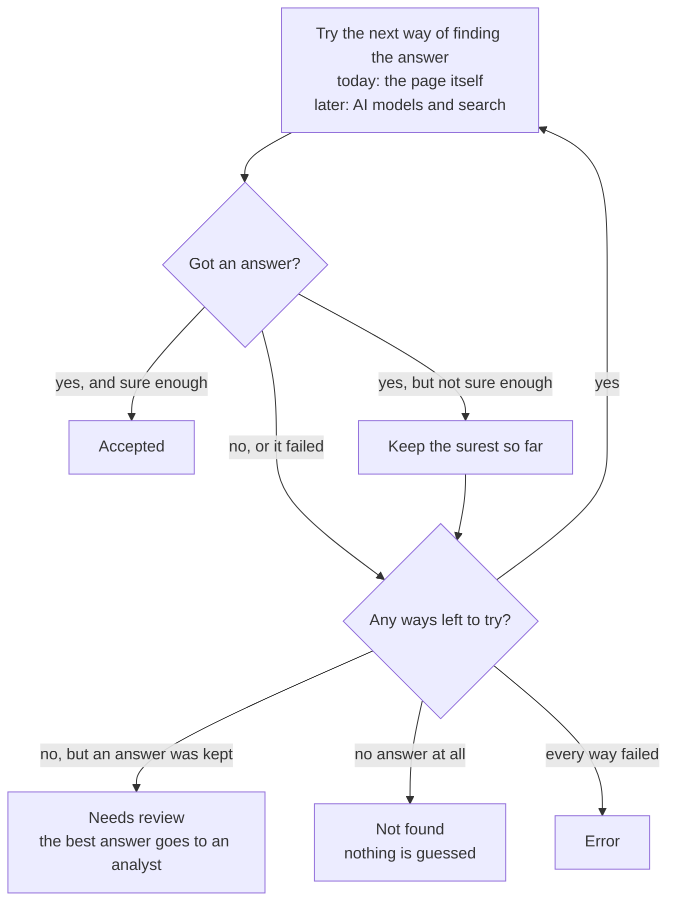
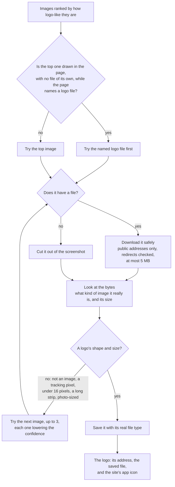
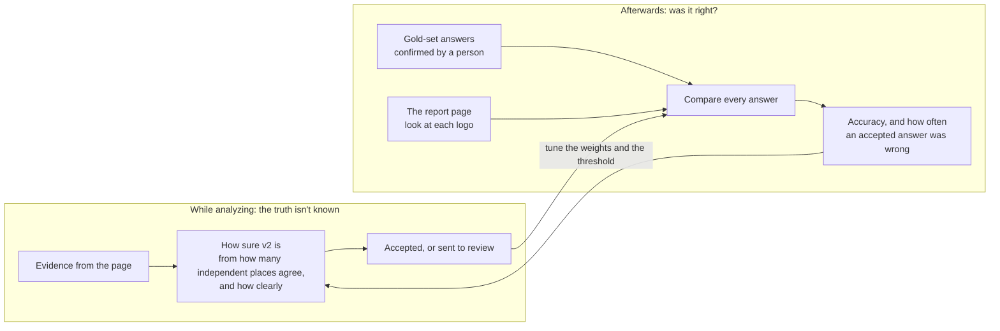
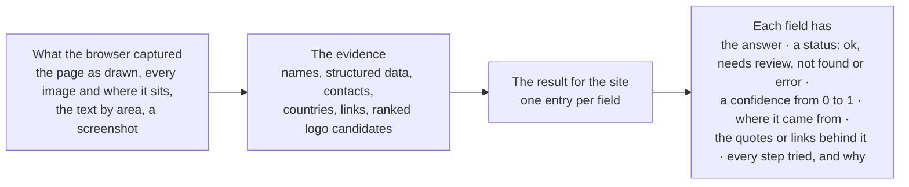
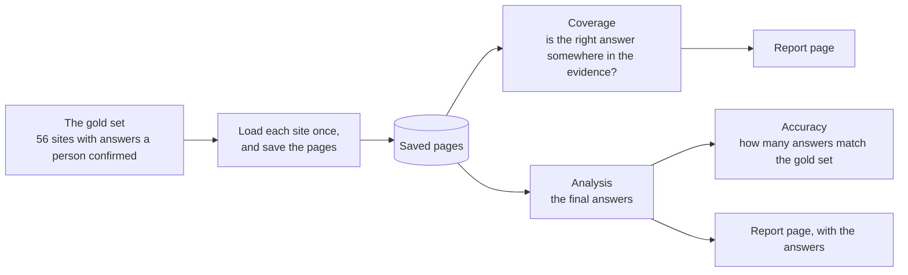

# Business Insights v2: progress review

Snapshot of 2026-10-12, after 37 commits. It covers what's built, how the parts fit together, how well it works on the gold set, how we know the answers are right, what's missing and what comes next. The design docs it builds on are [architecture.md](../architecture.md) (what and why) and [codebase.md](../codebase.md) (where and how).

## 1. Summary

- **What v2 is:** a rework of Business Insights for bank teams (merchant onboarding and underwriting, KYB, merchant risk, transaction enrichment) that finds a business's details from its website, cheaper, more accurately and faster than v1. The open-source terminal app is the product; a website demo comes later.
- **What works today:** `bi2 analyze <url>` loads a site in a real browser, collects its evidence, and answers four of the six fields with no AI calls at all: company name, logo, phone number and social media links. MCC and address aren't built yet, and the results say so instead of guessing.
- **How well**, on the 56-site gold set, with 0 model calls and 0 tokens:

  | Field | Right | What "accepted" meant (section 9) |
  |---|---|---|
  | Social links | 37 of 37 (100%) | |
  | Page kind (own site or platform page) | 54 of 56 (96%) | The 2 misses are sites that refused to load |
  | Company name | 52 of 56 (93%) | All 48 accepted names were right; the 1 wrong name had been sent to review |
  | Phone | 19 of 23 (83%) | No wrong number; the 4 misses show no number on their homepage |
  | Logo | 25 of 33 (76%) by the gold set's file match | All 36 accepted logos are right when looked at; the 4 wrong ones had been sent to review |
  | MCC, address | not built yet | Reported as "not built yet", never guessed |

- **How it's built:** a layered design whose rules are checked by tools in CI, 242 tests that need no network or keys, and CI on Windows, macOS and Linux with Python 3.12 and 3.14.
- **Biggest gaps:** MCC and address, the AI steps for answers the free sources can't settle, and logo downloads that some servers refuse.

## 2. Why v2, and what it must do better

v1 worked, but measuring it showed where the time and money went:

| What v1 did | What v2 does instead |
|---|---|
| Sent 4K–104K tokens of HTML per homepage to a model | Builds a compact, typed evidence bundle first; models only ever see that |
| Threw away the schema.org data sites publish for Google | Reads it: it often states the name, logo, phone, address and social profiles outright |
| Matched MCC keywords as substrings ("eat" in "great") | MCC is next, with a local search over the 914 codes |
| Turned failures into answers (a failed call became "restaurant") | Every field ends `ok`, `needs_review`, `not_found` or `error`, with its audit trail |
| Spent about 25 minutes of a 24-site run in fixed sleeps, one site at a time | Waits for pages to be ready, and runs sites and fields in parallel |
| Had no ground truth or tests | Has a 56-site gold set, an eval runner and 242 tests |

## 3. Architecture

### 3.1 How the parts fit together

The part that works out the answers never talks to a browser, the network or the disk directly. The dotted line is its only way out: it asks for those tools through **plugs** (interfaces), and the setup step plugs in the real ones. That's why the logic can be tested with stand-ins, and why the website will be able to reuse it unchanged.

### 3.2 The layers and the rules between them

Each arrow points to what a layer is allowed to use.

| Rule | Why |
|---|---|
| The shared building blocks use nothing else in v2 | Everything can depend on them safely |
| Working out the answers never uses the outside-world layer directly, only plugs | It's testable without a browser or network, and a provider can change without touching it |
| The outside-world layer never uses the answer logic | Each tool does one job |
| Neither the building blocks nor the answer logic load browser, network or AI libraries | Keeps them pure |

All four rules are checked automatically in CI, so a change that breaks one fails.

### 3.3 What's built, package by package

For finding your way around the code:

| Package | Status | Contents |
|---|---|---|
| `core/` | Built | Data models, plugs, settings, errors, text, URL and network-safety helpers |
| `fetch/` | Built | Browser page loading, safe downloads, the JavaScript run inside pages |
| `evidence/` | Built | Meta tags, structured data, text, countries, contacts, links, logos, platforms, names |
| `resolvers/` | 4 of 6 fields | The shared recipe, name, logo, phone, social links, image checks |
| `pipeline.py`, `wiring.py` | Built | One site start to finish; the setup for a terminal-app run |
| `adapters/local/` | Started | Results saved to a local folder |
| `cli/` | Built | `bi2 analyze`, `bi2 dev fetch`, `bi2 dev evidence`, `bi2 eval score`, the report page |
| `evaluation/` | Built | Gold set, scoring, evidence coverage, accuracy report |
| `llm/`, `decide/`, `retrieval/`, `services/`, `agent/` | Not started | Model gateway, Jev/LLM decisions, MCC search, search and geocoding, investigator |
| `adapters/hosted/`, website | Not started | Phase 4 |

About 5,200 lines of source and 2,800 lines of tests.

## 4. What happens when you analyze a site

The four fields are decided at the same time, since none depends on another. Several sites run at once (4 by default).

## 5. Loading pages

Every request the page makes, including redirects and images, is checked first, so a page can't make v2 reach a private network. Each page gets its own fresh browser session.

What the 56 real sites taught us, and what changed because of it:

| Finding | Change | Effect |
|---|---|---|
| Bot protection spots the fast browser (Shoppers, Loblaws, Best Buy, Roots) | Pages the fast browser is refused load again in a full one | Loaded sites went from 51 to 54–55 of 56 |
| Cloudflare's "Just a moment..." answers with an error, then moves on to the real page | Error pages with scripts get up to 10 seconds to move on | MEC loads |
| Akamai's check page says "200 OK" (Roots) | Check pages are recognized by their markers | Roots' real page loads instead of the check |
| Footers are drawn only once scrolled to; one hides again when scrolled away | Scroll to the bottom, read there, keep the fuller text | Footer addresses and phones are found |
| Pages that scroll smoothly were read part of the way down | Scroll instantly | Positions and screenshots are right |
| Logos link to `/en` or `/ca/en/homepage`, not `/` | A language's home page counts as home | The logo ranking is right more often |

A page takes about 8 seconds to load and read.

## 6. Evidence: everything collected before any AI

| Piece of evidence | What it gives |
|---|---|
| Tags | Title, description, site name, the title and image used when the page is shared |
| Structured data (schema.org) | The business's own statement of its name, legal name, logo, phone, address and profiles. v2 picks the part that describes the business, skipping the website, people and products |
| Visible text | Header, main and footer text as the browser drew it, without hidden menus |
| Countries | A ranked guess from the address, the web address's ending, postcodes, "City, Province" mentions, phone area codes and the page's language |
| Contacts | Phone numbers in international format with where each was found, emails, postcodes, the copyright line |
| Links | Social profiles (share buttons, posts and the platform's own pages don't count), and contact or about pages |
| Logo candidates | Every image the page drew, the logo the structured data names, and the site's icons, scored and numbered |
| Platform pages | For a Pinterest, Instagram, Yelp or similar page: the platform, the business's name from the title, and its own website. The platform's own logo, name and copyright line are left out |

Two data files hold the knowledge that changes most: the countries file (names, web address endings, postcode formats, provinces and states) and the platforms file (17 platforms and how their profile addresses look). Adding a country or a platform is one entry.

How often the right answer is already somewhere in the evidence, before any choice is made:

| Answer | In the evidence |
|---|---|
| Social links | 100% |
| Company name | 95% |
| Logo, among the candidates / ranked first | 94% / 85% |
| Phone | 83% |
| Country, as the top guess | 74% |
| Address, in the page text / in structured data | 33% / 22% |

## 7. Turning evidence into answers

Every field follows the same recipe: try each way of finding the answer in order, keep the first answer that's sure enough, and record why each try was or wasn't enough. Those records are the field's audit trail.

"Sure enough" means a confidence of 0.85 or more. Today each field has one way, the page itself. The AI ways will be added to the same recipe later, and they'll only run when the page isn't enough. That's where the savings come from.

| Field | How the page answers it | Accepted when | Sent to review when |
|---|---|---|---|
| Name | Adds up how many places on the page give the same name, and how telling each place is (section 9.1) | Well supported, e.g. the structured data alone, or part of the title plus a matching web address | One weak place, or a rival name nearly as strong |
| Phone | Where the number was found | 2 or more places (0.95), the structured data or a call link (0.9), the header or footer (0.85) | Only in the main text, where it could be anyone's |
| Social links | The profiles the business's own page links to, one per platform unless a handle has the business's name | On its own site (0.9), or on its platform page (0.95) | Not yet seen |
| Logo | The top-ranked image, downloaded and checked (sections 8 and 9.2) | A clear lead over the next image | A close call, or a fallback to a later image |

## 8. The logo, step by step

How images are scored: linking to the home page +4, in the header near the top +3, "logo" in its label, class or file name +3, named by the structured data +3, the business's name in it +2, near the top +1, logo-sized +1, shown more than once +1. Points come off for social icons, payment badges, cart, search and menu icons, arrows and flags (−4), tiny or photo-sized images (−3) and hidden ones (−1).

## 9. How we know an answer is right

There are two different questions, and they're answered in different ways:

1. **While analyzing, how sure is v2?** It can't know the truth; it only sees the page. It estimates a confidence from the evidence, and either accepts the answer or sends it to review.
2. **Were the answers actually right?** That's measured afterwards, against the gold set's answers, which a person confirmed, and for logos also by looking at each one.

The second question is what keeps the first one honest: if accepted answers start turning out wrong, the weights or the threshold get tuned, and the same check shows whether that helped.

### 9.1 The business name

**While analyzing.** A business names itself in many places on its own page. v2 collects them and treats different spellings of the same name as one, ignoring capital letters, accents, punctuation, a leading "The" and legal endings such as Inc., Ltd. and LLC. So "Example Cafe Ltd." and "EXAMPLE CAFE" count together. Then it adds up how telling each place is:

| Where the name appears | Weight | Why it counts that much |
|---|---|---|
| The structured data for search engines, or the profile name on a platform page | 3 | The business states its name on purpose, as data |
| The site name tag, a title that is only the name, or the copyright line | 2 | Written by the business, but sometimes holds a slogan |
| The web address (bellwoodsbrewery.com for "Bellwoods Brewery") | 2 | The business registered it, so a match is rarely a coincidence |
| Part of a title, or a logo's label | 1 | Often mixed with page names and slogans |

Page words like "Home", "Menu" or "Shop" never count, and on a platform page the platform's own name doesn't either. The total weight becomes a confidence: a total of 1 gives 0.5, 2 gives 0.7, 3 gives 0.85, 4 gives 0.9, and 5 or more gives 0.95. If another name is nearly as well supported, the confidence drops by 0.1. A confidence of 0.85 or more is accepted; anything lower goes to review.

Real examples from the gold-set run:

| Site | Name found | Where it was found | Confidence | Outcome |
|---|---|---|---|---|
| bellwoodsbrewery.com | Bellwoods Brewery | Structured data, site name, title, sharing title, copyright line, web address | 0.95 | Accepted |
| aircanada.com | Air Canada | Part of the title, part of the sharing title, web address | 0.9 | Accepted |
| coinbase.com | Coinbase Canada | Part of the title, part of the sharing title, web address, with a rival name close behind | 0.8 | Review; the gold set says "Coinbase" |

**Checking it afterwards.** Each of the 56 gold-set sites lists the accepted spellings of its name, confirmed by a person. The scoring compares each answer with them, using the same rules for different spellings.

| What v2 did | Sites | Right, by the gold set |
|---|---|---|
| Accepted the name | 48 | 48 |
| Sent it to review | 5 | 4: Best Buy Canada, Bellwoods Brewery on Instagram, Saint John's Tavern, Uber. The wrong one is "Coinbase Canada" |
| Found no name | 3 | Two pages refused to load; one titles itself only "Home" |

That's what "no wrong name was accepted" means: on this set, every name v2 accepted was right, and the one wrong name was sent to review rather than accepted.

**What this can't tell.**
- A business that uses one name everywhere is believed. That can be a trading name rather than the legal one ("Coinbase Canada"), or a new business on a domain that changed hands (graceomalleyspub.com is now a gambling site, and v2 correctly reports the business that's there now).
- 56 sites is a small sample. "No wrong name accepted" holds for this set, not as a guarantee, which is why the check is rerun as the gold set grows.
- A legal name needs business registries. That's planned with the banking fields in v2.1.

### 9.2 The logo

**While analyzing.** v2 doesn't look at what's in the pictures yet. It judges each image by where and how the page shows it, using conventions almost every site follows: the logo sits at the top, in the header, and links to the home page; its label or file name says "logo" or the business's name; and many sites name their logo file in their structured data. Those signals are the points in section 8. Then:

- **The confidence comes from the winner's lead.** At least 10 points and 3 ahead of the next image gives 0.9; at least 7 and 2 ahead gives 0.85. Both are accepted. A closer call gives 0.7 or less and goes to review.
- **The file is checked.** It's downloaded and must be a real image, judged by its content rather than its name. It must not be a tracking pixel, under 16 pixels, a long thin strip or photo-sized. If it fails, the next image is tried and the confidence drops by 0.15.

**Checking it afterwards, in two ways.**
1. **The gold set** lists the accepted logo files for 33 sites, confirmed by a person. The scoring compares file addresses, ignoring "www.", anything after a "?" and the size tags image hosts add, so `logo_300x.png` and `logo.png` match.
2. **By eye.** Every logo v2 chose was looked at on 2026-10-12, because a file match can't credit the right logo when it's saved under another address or cut out of the screenshot. Anyone can do the same check on the report page.

| What v2 did | Logos | Right, by eye | Details |
|---|---|---|---|
| Accepted | 36 | 36 | 22 match the gold set's file. 3 are the right logo in another file: McVeigh's, Canadian Red Cross, Rogers. 11 are on sites the gold set doesn't check |
| Sent to review | 11 | 6, plus Bellwoods' bell, part of its logo | The 4 wrong ones: a weather icon (Air Canada), a holiday promotion badge (Waterstones), a favicon (Warby Parker), an icon (Uber) |
| Found none | 9 | | 6 sites refused the download (MEC, Petro-Canada, OLG, Ted's Collision, The Only Cafe, University of Toronto). 3 pages had no images to choose from (Instagram without an account, and the Loblaws and Shoppers pages that refused to load) |

So far, every wrong logo had a low enough confidence to be sent to review.

**What this can't tell.**
- **What's in a picture.** An image placed like a logo, but that isn't one, earns points for its position, like a weather widget or a seasonal badge in the header. So far those scored low enough to go to review, but nothing guarantees it.
- **An old logo from the current one,** or a logo's symbol from the full logo with its name.
- **Clean cut-outs.** A logo cut out of the screenshot includes whatever covered the page at that moment. The Red Cross and Bellwoods cut-outs are darker than the real logos because a cookie or newsletter pop-up dimmed the page.

**What will close these gaps:**
- **The planned vision step.** It shows an AI model the screenshot with numbered boxes and asks "which number is the logo?". It runs only for the logos sent to review, which keeps the cost low.
- **Closing cookie banners** before the screenshot, which fixes the dimming.
- **Downloading through the browser** that loaded the page, which recovers the refused downloads.

## 10. What a result contains

Results check their own rules: an answer marked ok or needs review must have a value, a confidence and a source, and a field that wasn't answered can't carry a value, not even a guess. The result's format is versioned, so tools built on it know when it changes.

## 11. Measuring it

- **The gold set** has 56 sites: v1's 24, 30 others (retail, services, e-commerce, some high-risk) so a food bias would show, and 2 platform pages. Every answer has been confirmed.
- **Saved pages** let everything after page loading be rerun in seconds, offline, without loading the sites again.
- **Coverage** (section 6) shows the most the page could give; **accuracy** (section 1) shows what v2 gets right; section 9 shows how the two are checked.
- **The report page** shows every site with its screenshot, answers, evidence, logo candidates cut out of the screenshot, and the gold-set checks, with a filter for sites that miss an answer.
- **The v1 baseline** is ready to run but hasn't yet: it needs a Gemini key.

## 12. Commands

| Command | What it does |
|---|---|
| `bi2 analyze <urls>`, or `--gold FILE`, or `--saved DIR` | Runs everything; writes a results file, a folder per site and the report page |
| `bi2 eval score GOLD RESULTS` | Accuracy by field, and every answer that wasn't right |
| `bi2 dev fetch <url>`, or `--gold FILE` | Loads pages and shows what the browser captured; saves them for later runs |
| `bi2 dev evidence <url>`, or `--saved DIR --gold FILE` | Shows the evidence and how much of the gold set it holds; writes the report page |

Run them with `uv run` from the project folder. Add `--open` to open the report in a browser.

## 13. Code quality

- **Tests:** 242, all runnable with no network access and no keys. Evidence is tested on small pages written for the tests, never copies of real sites. Browser behavior is tested against a local test website that imitates bot checks, refusals, dropped connections, footers that appear on scroll, and smooth scrolling.
- **Checks:** linting and formatting, strict type checking, the layer rules, and hooks that run the same checks before each commit.
- **CI:** GitHub Actions runs the checks, then the tests on Ubuntu, Windows and macOS with Python 3.12 and 3.14.
- **Conventions:** modules are named after their topic (no "utils"), library code never prints, settings are read in one place, every dependency has a written reason, and commits follow Conventional Commits.

## 14. Timeline

| Milestone | Commits |
|---|---|
| Foundations: skeleton, data models, gold set and scoring, v1 baseline, phone and social fields | `init: project skeleton` to `test: confirm gold set` |
| Page loading: safety checks, browser choice, Edge, refused pages, bot checks | `feat: page loading with safety checks` to `docs: how pages load` |
| Evidence: tags, structured data, text, countries, contacts, links, logos, platform pages | `feat: evidence from meta tags, and bi2 dev evidence` to `feat: evidence from platform pages describes the business, not the platform` |
| Fixes found on real sites: bot-check pages that say 200, smooth scrolling, home page paths | `fix: recognize bot-check pages that say 200`, `fix: scroll back instantly before reading, and know more home page paths` |
| The report page | `feat: html report for bi2 dev evidence`, `docs: the evidence report` |
| Answers without AI: the shared recipe, name, phone, social links, logo, `bi2 analyze` | `feat: the cascade every field follows, with settings and a run context` to `feat: bi2 analyze, with results checked against the gold set` |

## 15. Known gaps and risks

| Gap | Effect today | Plan |
|---|---|---|
| MCC isn't built | 0% | A local search over the 914 codes, plus the business type from structured data, with a typed decision for close calls |
| Address isn't built | Only correct where the gold set says "none" | Structured data and footer text first (33% and 22% already in the evidence), then contact pages, then search and geocoding |
| No AI steps yet | Unsure answers stay "needs review" for an analyst | A model gateway with a cost log, and the decision step (an AI model first, Jev when access arrives), starting with "which number is the logo?" |
| Some servers refuse plain logo downloads | 6 logos missed | Download through the browser that loaded the page |
| Logos are judged by position, not by what they show | Wrong images can rank high; so far all went to review | The vision step for logos sent to review |
| Cut-out logos include pop-ups covering the page | Dimmed cut-outs (Red Cross, Bellwoods) | Close cookie banners before the screenshot |
| Gold-set questions | Scores slightly understate | Add the 3 right logo files, and confirm MEC's address (its site says 887 Great Northern Way; the gold set says 1077) |
| Shoppers Drug Mart and Loblaws sometimes refuse every browser | 1–2 sites don't load | Search as a fallback |
| The safety check looks a domain up again when connecting | A domain that changes its address in between isn't caught | Connect to the address that was checked |
| v1 baseline not run | No before-and-after comparison yet | Needs a Gemini key |
| Not started | | Config files and profiles, progress events, the interactive session, the website, the MCP server |

## 16. Next steps, and decisions for you

The roadmap order from here:

1. **Logo downloads through the browser**, a small change worth up to 6 logos.
2. **The AI layer:** the model gateway with cost tracking, and the decision step. Its first jobs are the "which number is the logo?" question and settling close name calls.
3. **MCC.**
4. **Address.**
5. **The interactive session and the first open-source release.**

Waiting on you:

- A **Gemini API key**, for the v1 baseline and the first AI steps
- **Jev access**, when the waitlist opens
- The **GitHub repository**, and a go-ahead to push
- The **package and command name** (`bi2` is a placeholder)
- The **gold-set questions** in section 15
