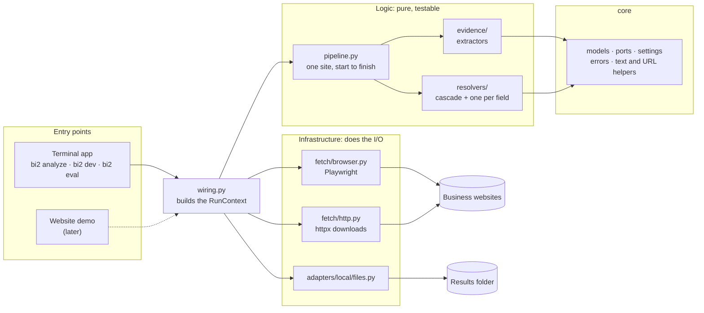
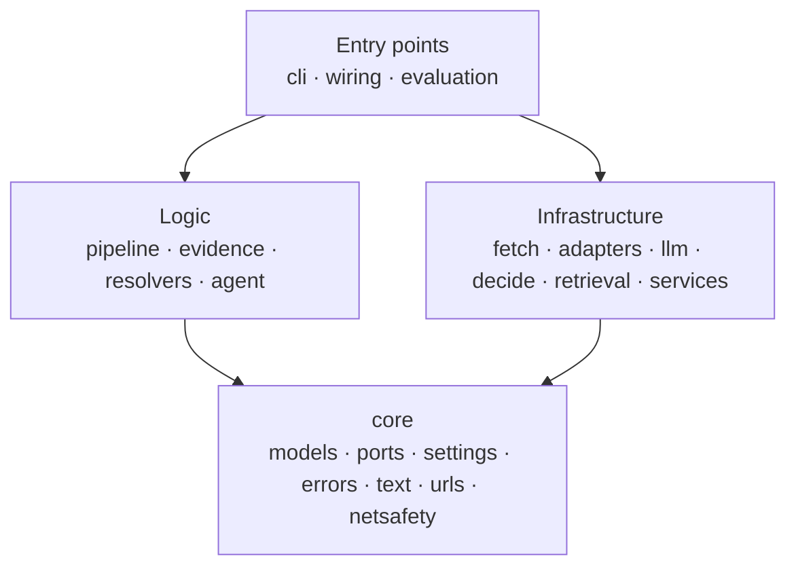
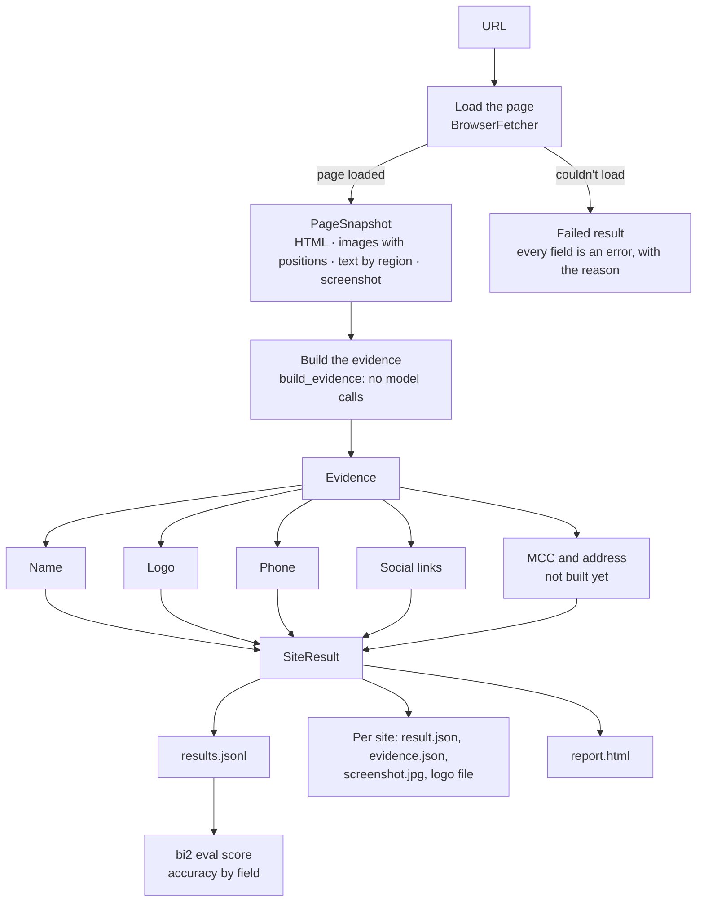
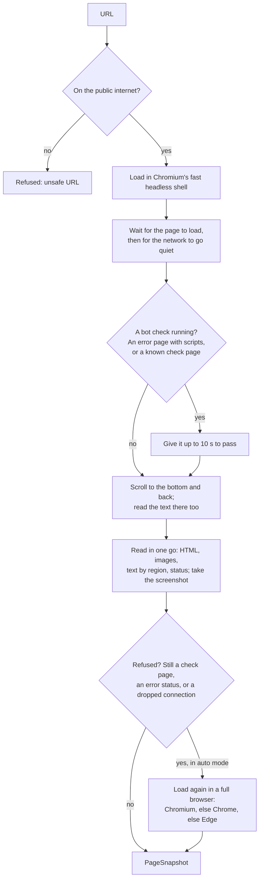
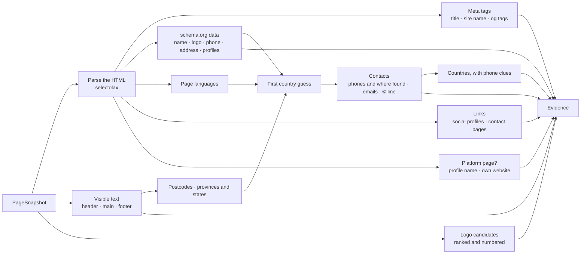
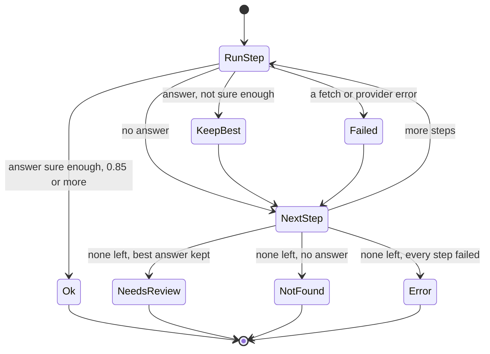
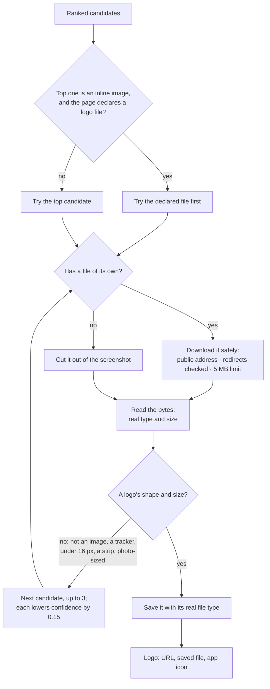
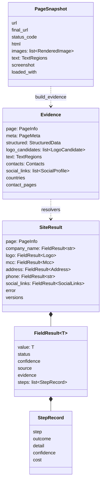
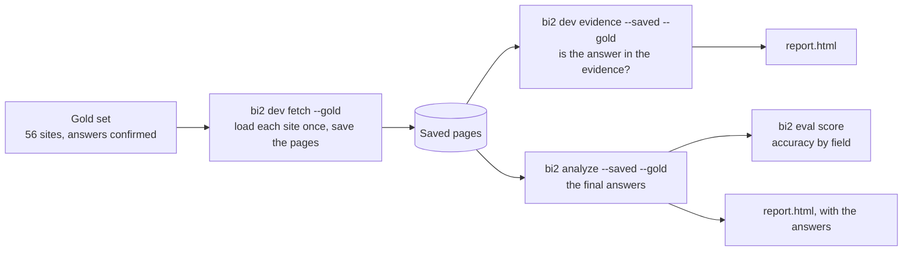

# Business Insights v2: progress review

Snapshot of 2026-10-12, after 37 commits. It covers what's built, how the parts fit together, how well it works on the gold set, what's missing and what comes next. The design docs it builds on are [architecture.md](../architecture.md) (what and why) and [codebase.md](../codebase.md) (where and how).

## 1. Summary

- **What v2 is:** a rework of Business Insights for bank teams (merchant onboarding and underwriting, KYB, merchant risk, transaction enrichment) that finds a business's details from its website, cheaper, more accurately and faster than v1. The open-source terminal app is the product; a website demo comes later.
- **What works today:** `bi2 analyze <url>` loads a site in a real browser, collects its evidence, and answers four of the six fields with no AI calls at all: company name, logo, phone number and social media links. MCC and address aren't built yet, and the results say so instead of guessing.
- **How well**, on the 56-site gold set, with 0 model calls and 0 tokens:

  | Field | Right | Notes |
  |---|---|---|
  | Social links | 37 of 37 (100%) | |
  | Page kind (own site or platform page) | 54 of 56 (96%) | The 2 misses are sites that refused to load |
  | Company name | 52 of 56 (93%) | No wrong name was accepted; doubtful ones go to review |
  | Phone | 19 of 23 (83%) | No wrong number; the 4 misses show no number on their homepage |
  | Logo | 25 of 33 (76%) | 4 of the 8 misses are the right logo in another file than the gold set lists |
  | MCC, address | not built yet | Reported as "not built yet", never guessed |

- **How it's built:** a layered design whose rules are checked by tools in CI, 242 tests that need no network or keys, and CI on Windows, macOS and Linux with Python 3.12 and 3.14.
- **Biggest gaps:** MCC and address, the AI steps for answers the free sources can't settle, and logo downloads that some servers refuse.

## 2. Why v2, and what it must do better

v1 worked, but measuring it showed where the time and money went:

| What v1 did | What v2 does instead |
|---|---|
| Sent 4K–104K tokens of HTML per homepage to a model | Builds a compact, typed evidence bundle first; models only ever see that |
| Threw away the schema.org data sites publish for Google | Reads it: it often states the name, logo, phone, address and social profiles outright |
| Matched MCC keywords as substrings ("eat" in "great") | MCC is next, with a local embedding search over the 914 codes |
| Turned failures into answers (a failed call became "restaurant") | Every field ends `ok`, `needs_review`, `not_found` or `error`, with its audit trail |
| Spent about 25 minutes of a 24-site run in fixed sleeps, one site at a time | Waits for pages to be ready, and runs sites and fields in parallel |
| Had no ground truth or tests | Has a 56-site gold set, an eval runner and 242 tests |

## 3. Architecture

### 3.1 How the parts fit together

The logic never talks to a browser, the network or the disk directly. It asks for those through **ports** (interfaces in `core/ports.py`), and `wiring.py` plugs in the real implementations. That's why the logic can be tested with stand-ins, and why the website will be able to reuse it unchanged.

### 3.2 The layers and the rules between them

| Rule | Why |
|---|---|
| `core` imports nothing else from v2 | Everything can depend on it safely |
| Logic never imports infrastructure; it uses ports | Logic is testable without a browser or network, and providers can change without touching it |
| Infrastructure never imports logic | Each adapter does one job |
| `core` and logic never import I/O libraries (Playwright, httpx, model SDKs, keyring, fastembed) | Keeps them pure |

All four rules are import-linter contracts, so CI fails if a change breaks one.

### 3.3 What's built, package by package

| Package | Status | Contents |
|---|---|---|
| `core/` | Built | Data models, ports, settings, errors, text, URL and network-safety helpers |
| `fetch/` | Built | Browser page loading, safe downloads, the JavaScript run inside pages |
| `evidence/` | Built | Meta tags, structured data, text, countries, contacts, links, logos, platforms, names |
| `resolvers/` | 4 of 6 fields | The cascade, name, logo, phone, social links, image checks |
| `pipeline.py`, `wiring.py` | Built | One site start to finish; the run context for the terminal app |
| `adapters/local/` | Started | Results saved to a local folder |
| `cli/` | Built | `bi2 analyze`, `bi2 dev fetch`, `bi2 dev evidence`, `bi2 eval score`, the HTML report |
| `evaluation/` | Built | Gold set, scoring, evidence coverage, accuracy report |
| `llm/`, `decide/`, `retrieval/`, `services/`, `agent/` | Not started | Model gateway, Jev/LLM decider, MCC search, search and geocoding, investigator |
| `adapters/hosted/`, website | Not started | Phase 4 |

About 5,200 lines of source and 2,800 lines of tests.

## 4. What happens when you analyze a site

The four fields are resolved at the same time, since none depends on another. Several sites run at once (4 by default).

## 5. Loading pages

Every request the page makes, including redirects and images, is checked first, so a page can't make v2 reach a private network. Each page gets its own browser context.

What the 56 real sites taught us, and what changed because of it:

| Finding | Change | Effect |
|---|---|---|
| Bot protection spots the fast shell (Shoppers, Loblaws, Best Buy, Roots) | Pages the shell is refused load again in a full browser | Loaded sites went from 51 to 54–55 of 56 |
| Cloudflare's "Just a moment..." answers 403, then moves on to the real page | Error pages with scripts get up to 10 s to move on | MEC loads |
| Akamai's check page says "200 OK" (Roots) | Check pages are recognized by their markers | Roots' real page loads instead of the check |
| Footers are drawn only once scrolled to; one hides again when scrolled away | Scroll to the bottom, read there, keep the fuller text | Footer addresses and phones are found |
| Pages that scroll smoothly were read mid-scroll | Scroll instantly | Positions and screenshots are right |
| Logos link to `/en` or `/ca/en/homepage`, not `/` | Language home pages count as home | Logo ranking is right more often |

A page takes about 8 seconds to load and read. Chrome and Edge can be picked with `--browser`.

## 6. Evidence: everything collected before any AI

| Extractor | What it gives |
|---|---|
| Meta tags | Title, description, site name, og:title, sharing image |
| schema.org (JSON-LD) | The business's own statement of its name, legal name, logo, phone, address and profiles. It picks the node that is the business, skipping the website, people and products |
| Visible text | Header, main and footer text as the browser drew it, without hidden menus |
| Countries | A ranked guess from the address, web address ending, postcodes, "City, Province" mentions, phone area codes and page language |
| Contacts | Phone numbers in international format with where each was found, emails, postcodes, the © line |
| Links | Social profiles (share buttons, posts and the platform's own pages aren't profiles), and contact or about pages |
| Logo candidates | Every image the page drew, the declared logo and the site icons, scored and numbered |
| Platform pages | For a Pinterest, Instagram, Yelp or similar page: the platform, the business's name from the title, and its own website. The platform's own logo, name and © line are left out |

Two data files hold the knowledge that changes most: `data/countries.toml` (names, domains, postcode formats, provinces and states) and `data/platforms.toml` (17 platforms and their profile URL patterns). Adding a country or a platform is one entry.

How often the right answer is already somewhere in the evidence, before any choice is made:

| Answer | In the evidence |
|---|---|
| Social links | 100% |
| Company name | 95% |
| Logo, among the candidates / ranked first | 94% / 85% |
| Phone | 83% |
| Country, as the top guess | 74% |
| Address, in the page text / in structured data | 33% / 22% |

## 7. Turning evidence into answers

Every field follows the same recipe, `run_cascade`: try each step in order, keep the first answer that's sure enough, and record why each step was or wasn't enough.

Today each field has one step, the free one. The AI steps will be added to the same lists later, and they'll only run when the free step isn't sure. That's where the savings come from.

| Field | How the free step decides | Accepted when | Sent to review when |
|---|---|---|---|
| Name | Groups the places a page names itself and adds up their weight: schema data or profile name 3, site name, a plain title or the © line 2, a title fragment or logo label 1, matching the web address 2 | 3 or more, e.g. schema data alone, or a title fragment that matches the web address | One weak place, or a rival name nearly as strong |
| Phone | Where the number was found | 2 or more places (0.95), schema data or a call link (0.9), header or footer (0.85) | Only in the main text, where it could be anyone's |
| Social links | Profiles the business's own page links to, one per platform unless the handle has the business's name | On its own site (0.9), on its platform page (0.95) | Never yet |
| Logo | The top candidate, downloaded and checked (section 8) | A clear lead: 10+ points and 3 ahead (0.9), or 7+ and 2 ahead (0.85) | A close call, or a fallback to a later candidate |

## 8. The logo, step by step

How candidates are scored: linking home +4, in the header near the top +3, "logo" in its label, class or file name +3, declared by the schema data +3, the business's name in it +2, near the top +1, logo-sized +1, drawn more than once +1. Points come off for social icons, payment badges, cart, search and menu icons, arrows and flags (−4), tiny or photo-sized images (−3) and hidden ones (−1).

Of the 8 logo misses:

| Why | Sites | What fixes it |
|---|---|---|
| The right logo, in another file than the gold set lists | 4: bellwoods, mcveighspub, redcross, rogers | Add those files to the gold set (two are cut-outs of inline SVG logos, which can't match a URL) |
| The server refuses plain downloads (403) | 3: OLG, utoronto, tedscollision | Download through the browser that loaded the page |
| The schema data declares the favicon as the logo | 1: Warby Parker | The vision step, or ignoring declared favicons |

## 9. The data model

Every model is immutable and rejects unknown keys, and results enforce their own rules: an answer marked `ok` or `needs_review` must have a value, a confidence and a source, and a field that wasn't answered can't carry a value, not even a guess. The JSON form of `SiteResult` is the output contract, with a schema version.

## 10. Measuring it

- **The gold set** has 56 sites: v1's 24, 30 others (retail, services, e-commerce, some high-risk) so a food bias would show, and 2 platform pages. Every answer has been confirmed.
- **Saved pages** let the extractors and resolvers be re-run in seconds, offline, without loading the sites again.
- **Coverage** (section 6) shows the most the free sources could get right; **accuracy** (section 1) shows what they do get right.
- **The report page** shows every site with its screenshot, answers, evidence, logo candidates cut out of the screenshot, and the gold checks, with a filter for sites that miss an answer.
- **The v1 baseline** harness is ready but hasn't run yet: it needs a Gemini key.

## 11. Commands

| Command | What it does |
|---|---|
| `bi2 analyze <urls>` / `--gold FILE` / `--saved DIR` | Runs the pipeline; writes `results.jsonl`, a folder per site and `report.html` |
| `bi2 eval score GOLD RESULTS` | Accuracy by field, and every answer that wasn't right |
| `bi2 dev fetch <url>` / `--gold FILE` | Loads pages and shows what the browser captured; saves them for later runs |
| `bi2 dev evidence <url>` / `--saved DIR --gold FILE` | Shows the evidence and how much of the gold set it holds; writes `report.html` |

Run them with `uv run` from the project folder. Add `--open` to open the report in a browser.

## 12. Code quality

- **Tests:** 242, all runnable with no network access and no keys. Extractors are tested on small pages written for the tests, never copies of real sites. Browser behavior is tested against a local test website that imitates bot checks, refusals, dropped connections, lazy footers and smooth scrolling.
- **Checks:** ruff (lint and format), mypy in strict mode, import-linter for the layers, and pre-commit hooks that run the same checks before each commit.
- **CI:** GitHub Actions runs the checks, then the tests on Ubuntu, Windows and macOS with Python 3.12 and 3.14.
- **Conventions:** modules are named after their topic (no `utils`), library code never prints, settings are read in one place, every dependency has a written reason, and commits follow Conventional Commits.

## 13. Timeline

| Milestone | Commits |
|---|---|
| Foundations: skeleton, models, gold set and scoring, v1 baseline harness, phone and social fields | `init: project skeleton` to `test: confirm gold set` |
| Page loading: safety checks, browser choice, Edge, refused pages, bot checks | `feat: page loading with safety checks` to `docs: how pages load` |
| Evidence: meta tags, structured data, text, countries, contacts, links, logos, platform pages | `feat: evidence from meta tags, and bi2 dev evidence` to `feat: evidence from platform pages describes the business, not the platform` |
| Fixes found on real sites: 200 bot-check pages, smooth scrolling, home page paths | `fix: recognize bot-check pages that say 200`, `fix: scroll back instantly before reading, and know more home page paths` |
| The report page | `feat: html report for bi2 dev evidence`, `docs: the evidence report` |
| Answers without AI: the cascade, name, phone, social links, logo, `bi2 analyze` | `feat: the cascade every field follows, with settings and a run context` to `feat: bi2 analyze, with results checked against the gold set` |

## 14. Known gaps and risks

| Gap | Effect today | Plan |
|---|---|---|
| MCC isn't built | 0% | A local embedding search over the 914 codes, plus schema.org business types, with a typed decision for close calls |
| Address isn't built | Only correct where the gold set says "none" | Structured data and footer text first (33% and 22% already in the evidence), then contact pages, then search and geocoding |
| No AI steps yet | Unsure answers stay `needs_review` for an analyst | A model gateway with a cost log, and the Decider (an LLM first, Jev when access arrives), starting with "which number is the logo?" |
| Some servers refuse plain logo downloads (403) | 3 logos missed | Download through the browser that loaded the page |
| Gold-set questions | Scores slightly understate | Confirm 4 logo files and MEC's address (its site says 887 Great Northern Way; the gold set says 1077) |
| Shoppers Drug Mart and Loblaws sometimes refuse every browser | 1–2 sites don't load | Search as a fallback |
| The network checks look a domain up again when connecting | A domain that changes its address in between isn't caught | Connect to the address that was checked |
| v1 baseline not run | No before-and-after comparison yet | Needs a Gemini key |
| Not started | — | Config files and profiles, progress events, the interactive session, the website, the MCP server |

## 15. Next steps, and decisions for you

The roadmap order from here:

1. **Logo downloads through the browser**, a small change worth about 3 logos.
2. **The AI layer:** the model gateway with cost tracking, and the Decider. Its first jobs are the "which number is the logo?" question and settling close name calls.
3. **MCC.**
4. **Address.**
5. **The interactive session and the first open-source release.**

Waiting on you:

- A **Gemini API key**, for the v1 baseline and the first AI steps
- **Jev access**, when the waitlist opens
- The **GitHub repository**, and a go-ahead to push
- The **package and command name** (`bi2` is a placeholder)
- The **gold-set questions** in section 14
